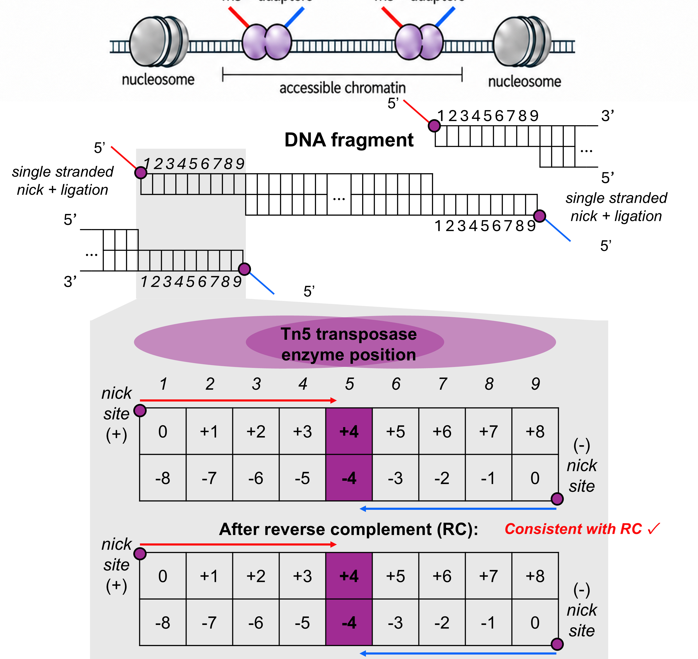
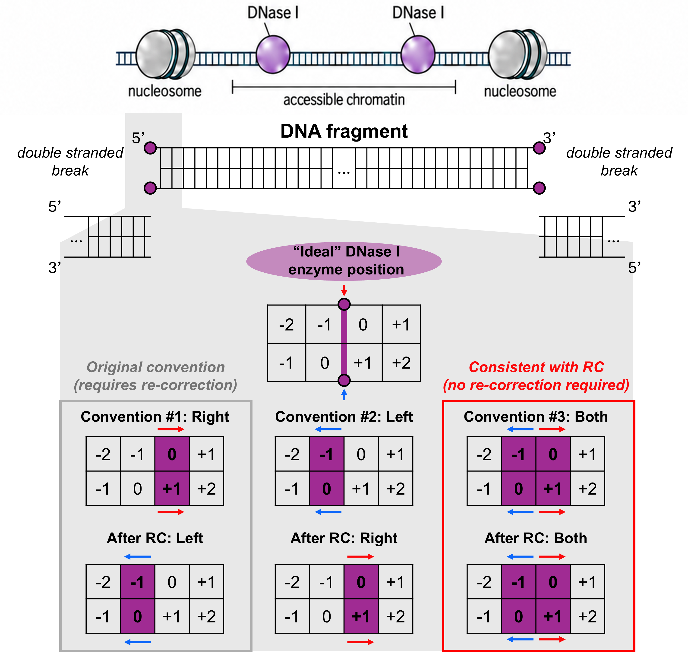


__ChromBPNet__ is a deep learning model of regulatory DNA that models chromatin accessibility at base-resolution with DNase I/Tn5 transposase enzyme bias-factorization. Despite wide use of the model, there have been several improvements that we had been considering. Here, we apply those updates and present a [__refactored codebase of ChromBPNet__](https://github.com/kundajelab/chrombpnet-refactor/), that includes the following updates and improvements: (1) updated support on modern packages and hardware, with flexibility across all 3 major deep learning frameworks: PyTorch, TensorFlow and JAX; (2) a corrected, flexible cut-site convention for DNase-seq; (3) optimizations from Anthropic’s Claude Fable/Mythos 5.1 [model release](https://www.anthropic.com/claude-fable-and-mythos-5-1) for ChromBPNet’s pipeline; and (4) further optimizations in pre- and post-processing. For all updates, we confirmed reproducibility with the original model, across numerical agreement (where possible), model performance, and intepretation. We share this study to showcase how deep learning model implementations can be reliably optimized despite non-deterministic numerical identity, and highlight the benefits of early open access code to help build better software as a community.


---
## ChromBPNet: A bias-factorized, base-resolution deep learning model of chromatin accessibility

ChromBPNet is a deep learning model of __chromatin accessibility__, where:
- __Chromatin__: is the native state of a DNA molecule in eukaryotic cells, packaged into a dense, compact structure with other proteins, such as histones, and RNA. 
- __Accessibility__: quantifies how non-compact/exposed the DNA is at each position, for it to freely interact with other cellular processes, such as RNA transcription.

Differences in chromatin accessibility is a defining feature of cell type identity: different cell types can have drastically different levels of accesibility for a given position on the genome, that is typically related to its proximity towards essential genes for the given cell type.

Given the importance of chromatin accessibility, many experiments have been developed to measure chromatin accessibility across different cell types: 
- __DNase-seq__: uses the enzyme, DNase I, to cut exposed chromatin into small fragments, that are then sequenced to identify where the exposed regions are.
- __ATAC-seq__: uses the enzyme, Tn5 transposase, to fragment accessible chromatin, that again, is sequenced to identify accessible regions.

In short: The more accessible a region of chromatin is > The more its DNA gets cut up by the enzymes > Produces more short DNA fragments > More fragments are sequenced by next generation sequencing (NGS) > The sequenced fragments are mapped to find its genomic location > The number of sequenced fragments at each position are counted, piling up as a tall "peak" in the signal > Overall, the "height" of the signal quantifies how accessible the DNA is at that position.

 DNA that is wrapped around proteins and RNA, such as histones, is relatively inaccessible, whereas (2) exposed DNA can be cut by enzymes: DNase-I or Tn5 transposase. These enzymes preferentially act on accessible DNA, and the resulting fragments are isolated, (3) sequenced, and mapped back to the genome. (4) Regions where many fragments accumulate appear as "peaks" of chromatin accessibility.")

While measuring the accessibility of chromatin is the primary goal of the experiments, the enzymes–DNase I and Tn5 transposase–each have a unique DNA-cutting mechanism and an innate preference towards particular DNA sequences, that causes the observed signal to reflect a combination of both true chromatin accessibility and assay-specific artifacts. Deconvolving these two signals can be particularly important when understanding the signal at single-base resolution.

To address this issue, we developed ChromBPNet: a deep learning model trained to predict chromatin accessibility signal from DNA sequence at base-resolution, with explicit factorization of the enzyme’s artifact bias. ChromBPNet, together with robust model interpretation methods, [has previously been shown](https://doi.org/10.1101/2024.12.25.630221) to predict accessibility in unseen chromosomes, identify the binding preference and binding sites of known, cell type-specific transcription factors (TFs), and predict the effects of genomic variation on accessibility (caQTLs) across cell type and population. Further, we expanded the model across a broader range of cell types, training 1,512 ChromBPNet models across 408 samples as part of [ENCODE GRAMMAR](https://genomicsxai.github.io/blogs/2026-012/).

However, with production-level use, we began to identify several areas of improvement to ChromBPNet—which we have now implemented in [`chrombpnet-refactor`](https://github.com/kundajelab/chrombpnet-refactor/).

## 1. Support implementation across all 3 major deep learning libraries, on modern hardware: PyTorch, TensorFlow, JAX

> _Note: We are grateful for [Eugenio Mattei](https://github.com/emattei) at the Broad Institute for implementing [an initial JAX version of the original ChromBPNet](https://github.com/kundajelab/chrombpnet/pull/284), that inspired our expansion to other libraries._

__Problem__: Deep learning advances rapidly. The development of the original ChromBPNet began in 2021, and was developed on top of the latest deep learning hardware and packages at the time: TensorFlow 2.8 on Python 3.8. However, the deep learning stack has evolved considerably since, making ChromBPNet often poorly compatible with current packages and hardware.

__Solution__: Here, we reimplemented ChromBPNet across all 3 major deep learning libraries: PyTorch 2.14.1 (default), TensorFlow 2.21.0 (with tf-keras 2.21.0, the Keras 2 API), and JAX 0.11.2 (with Keras 3.15.1), all behind one shared, framework-neutral pipeline. This allows better compatibility with modern hardware (e.g., H100/H200) and modern packages (e.g., [`tangermeme`](https://github.com/jmschrei/tangermeme)).

__How to use__: Each engine has its own conda environment. Create the ones you need from the repository root:

| Engine | How to create the environment | Activate the environment | Version |
|---|---|---|---|
| PyTorch _(default)_ | `conda env create -f envs/chrombpnet-pytorch.yml` | `conda activate chrombpnet-pytorch` | PyTorch 2.14.1 (Python 3.12) |
| TensorFlow | `conda env create -f envs/chrombpnet-tensorflow.yml` | `conda activate chrombpnet-tensorflow` | TensorFlow 2.21.0 (Python 3.12; Keras 3.15.1) |
| JAX | `conda env create -f envs/chrombpnet-jax.yml` | `conda activate chrombpnet-jax` | JAX 0.11.2 (Python 3.12; Keras 3.15.1) |

Pick the engine with `--engine` (the checkpoint suffix decides when it is omitted) and the device with `--device cpu`, `cuda` or e.g. `cuda:1`. [`envs/README.md`](https://github.com/kundajelab/chrombpnet-refactor/blob/main/envs/README.md) describes each engine, its GPU libraries, and what differs between them.

As default: We recommend using PyTorch, given broad compatibility with modern hardware and related deep learning packages (e.g., [`tangermeme`](https://github.com/jmschrei/tangermeme)).

## 2. Adaptable cut-site convention for DNase-seq

> _Note: We are grateful to our colleagues at [Relation Therapeutics](https://www.relationrx.com/) for identifying this issue to us._

__Problem__: ChromBPNet is a supervised deep learning model that takes as input a short length of DNA sequence (2,114 bp), and outputs the predicted chromatin accessibility of the given DNA sequence (at its center 1,000 bp) at single-base resolution for a set cell type. Hence, during model training, the model's output is supervised by the experimental observed chromatin accessibility track for the input sequence at single-base resolution.

To construct the observed experimental signal track at single-base resolution, we first map the sequenced DNA fragments, and count only the 5' end positions of each fragment. This prevents any read bias from fragments of different lengths. Next, we process the 5' end reads, so that reads from the forward (+) stand and the reverse (-) strand line up with each other. This processing depends on the type of enzyme used, depending on the enzyme's molecular mechanism of cleavage.

__ATAC-seq__: When Tn5 transposase–a homodimer enzyme–cleaves DNA, it creates two distal single-stranded cuts (using each subunit to create one cut each) that are 9 bp away from each other. Therefore, for the same cleavage event, if viewed as raw 5' end reads, the read from the forward strand would be 9 bp away from the read from the reverse strand. Hence, depending on whether the cleavage event was identified by the forward strand or the reverse strand, the cleavage position would vary by 9 bp. Therefore, to synchronize the cuts from each strand to one coherent position, we symmetrically shift the forward strand forward by 4 bp (+4 shift), and shift the reverse strand backward by 4 bp (-4 shift). This allows the reads from either strand to pile up at the same position–at the center of the 9 bp gap. This has been the standard processing to construct the observed experimental track ATAC-seq in ChromBPNet, and remains consistent in `chrombpnet-refactor`.

_(Note: The +4/-4 shift is a convention. E.g., Shifts of +5/-3, +3/-5, +7/-1, etc. would also all produce a feasible agreement between the forward and reverse strand reads. However, as the shift is asymmetric, the signal would be skewed towards one direction.)_

__DNase-seq__: However, unlike Tn5 transposase, when DNase I–a monomer enzyme–cleaves DNA, it simply creates one double-stranded break at a single site. While mechanistically, this is easier to understand and visualize, when synchronizing reads from the forward strand and the reverse strand, as the gap is even (0 bp), there is no longer an integer shift that can align the reads symmetrically, and each read would need to be shifted by half a position (+0.5/-0.5) to stay symmetric–which in a discrete, one-hot coordinate system, is not possible.

Therefore, generally, we have the following options to shift and synchronize the fragments: 
- Option I: Align on the position of the forward strand's read, by keeping the forward strand's read position constant and shifting the reverse strand read to the right by 1 bp (0/+1; i.e., the "right-hand" convention)
- Option II: Align on the position of the reverse strand's read, by keeping the reverse strand's read position constant and shifting the forward strand's read to the left by 1 bp (-1/0; i.e., the "left-hand" convention)
- Option III: Align on _both_ the forward and reverse strand's position, by assigning a read on both positions (-1/0 and 0/+1). 

In the original ChromBPNet, we selected Option I: the right-hand side convention (0 bp shift on the positive strand, +1 bp shift on the negative strand). This ensured that irrespective of which direction of the break was sequenced, we stacked counts on the same position, despite the shift being asymmetric.

However, this __asymmetric shift__ led to an issue during a step in training. During model training, since all chromatin is double-stranded but NGS sequencing typically only returns single-stranded reads, like many DNA sequence models, we could naturally augment and double the training data by simply taking the reverse complement of all the sequenced 5' reads. And to avoid repeating a second batch of mapping and processing of raw reads, we could simply apply the reverse complement after the processing, directly on the aligned signal track. Previously, ChromBPNet also followed this training protocol: it was trained on a reverse complement-augmented training dataset, by doubling each raw data point by taking as input the forward and reverse complement DNA sequence one time each, and predicting the forward and reversed chromatin accessibility signal one time each. 

When taking the reverse complement, the operation not only inverted the sequence and signal, but also inverted the _shift convention_. For a symmetric convention (e.g., in ATAC-seq), the inverted convention was still identical. However, for a asymmetric convention (e.g., in DNase-seq), the inversion led to two different conventions between the original data and the reverse complement-augmented data: right-hand convention for the original data, and left-hand convention for the reverse complement-augmented data. Effectively, this smeared the single-base pair resolution of the original training signal across to two adjacent base pairs.

This explained several phenomena we had observed. 

__Issue #1: ATAC-seq vs. DNase-seq__: First, during evaluation of ChromBPNet, comparing model performance on ATAC-seq vs. DNase-seq, while the counts head prediction (= predicted total counts inside the 1 kb region) performance was comparable between the two assays (ATAC-seq: ~0.7 vs. DNase-seq: ~0.7; Pearson correlation; higher = better), the profile head prediction (= predicted distribution of the total counts, as a probability distribution; where counts x prediction = predicted signal) performance was significantly worse in DNase-seq (ATAC-seq: ~0.4–0.6 vs. DNase-seq: ~0.65–0.9; Jensen-Shannon distance (JSD); lower = better).

. Right: Profile head performance, evaluated by Jensen-Shannon distance (lower = better). While counts head performance is comparable (left), profile head performance in DNase-seq is consistently worse than in ATAC-seq (right). From _Pampari et al._ (2024).")

__Issue #2: ChromBPNet vs. Other models (e.g., AlphaGenome)__: Second, this was also observed in benchmarks against other models. For example, in comparison with AlphaGenome, ChromBPNet’s profile prediction performance was only lower than AlphaGenome by 1.6% in ATAC-seq (by relative improvement in profile JSD), but was significantly lower in DNase-seq by 6.4%.

. Top: Comparison on DNase-seq tracks. Bottom: Comparison on ATAC-seq tracks. Value: Relative % improvement in performance. AlphaGenome saw large improvements (+6.4%) on DNase-seq track prediction over ChromBPNet, but saw only marginal improvements (+1.6%) on ATAC-seq track predictions. From _Avsec et al._ (2026).")

To investigate further, we performed two thorough evaluations on the impact of the shift convention bug, by training and comparing ChromBPNet models across six possible shift convention and data augmentation combinations, across 4 datasets (2 DNase-seq, 2 ATAC-seq): 

__Original ChromBPNet vs.__: The original ChromBPNet’s right-hand side (0/+1) convention training data, with the reverse complement-augmented bug.

1. __forward-only__: The original ChromBPNet’s right-hand side (0/+1) convention training data, but _without_ the reverse complement-augmented data (i.e., half the training data).
2. __reverse complement-only__: The original ChromBPNet’s “right-hand side (0/+1)” convention training using the reverse complement-augmented data _only_ (i.e., the other half of the training data used to the train the original model; in other words, in reality, a left-hand side (-1/0) convention).
3. __right-hand__: (Corrected) Right-hand side (0/+1) convention, in both forward and reverse complement-augmented data.
4. __left-hand__: Left-hand side (-1/0) convention, in both forward and reverse complement-augmented data.
5. __both-side (half)__: Symmetric (-1/0 and 0/+1) convention, by assigning a half count to both sides.
6. __both-side (full)__: Symmetric (-1/0 and 0/+1) convention, by assigning full count to both sides (i.e., double the total counts).

__Performance__: We observed that using half the data (original, or augmented) alone already improved profile performance (in K562 DNase-seq, with performance defined as 1-JSD: original: 0.45 vs. forward-only/reverse complement-only: 0.50), while degrading counts head performance (original: 0.71 vs. forward-only/reverse complement-only: 0.68/0.69), since only half the data was used (the same drop was also observed in ATAC-seq: original 0.70 vs. forward-only/reverse complement-only: 0.68). The counts performance was fully recovered when a consistent convention was applied across the full, double-augmented data using either right-hand or left-hand side convention (original: 0.71 vs. right-hand/left-hand: 0.71), while the improved profile head performance was maintained (forward-only/reverse complement-only: 0.50 vs. right-hand/left-hand: 0.50). Both symmetric (-1/0 and 0/+1) conventions (half, full) showed recovered counts head performance (original: 0.71 vs. both-full/half: 0.70) and the highest profile head performance (forward-only/reverse complement-only/right-hand/left-hand: 0.50 vs. both-full/half: 0.56), due to smoothed profiles.

, using the original ChromBPNet preprocessing without reverse complement-augmented data. `rc-only`: Reverse complement only (`--data-aug revcomp-only`), using the original ChromBPNet’s reverse complement augmentation data only. `right`: Corrected right-hand side (0/+1) convention. `left`: Corrected left-hand side (-1/0) convention. `both-half`: Symmetric (-1/0 and 0/+1) convention, assigning half count to both sides. `both-full`: Symmetric (-1/0 and 0/+1) convention, assigning full integer count to both sides. Red: Counts head performance, evaluated by Pearson correlation (higher = better). Blue: Profile head performance, evaluated by 1 - JSD (higher = better). Repeated in ATAC-seq and DNase-seq in the same cell line (K562) and primary cell type (stomach).")

__Cross-convention performance__: Further, to understand how each model would perform based on the other's shift convention, we performed cross-evaluation between the original and the newly trained models when tested on their corresponding test sets. For more detail, see [Appendix: 2. Adaptable cut-site convention for DNase-seq (continued)](#appendix-2-adaptable-cut-site-convention-for-dnase-seq-continued).

Overall, from the investigation, we could conclude that: 
- The model had (unintentionally) been trained on a mix of half right-hand side convention (from the original data) and half left-hand side convention (from the reverse complement-augmented data).
- Hence, during prediction, the model was predicting an expectation between the two shift conventions.
- This happened to be equivalent to the symmetric shift convention.

__Solution__: Moving forward, we have implemented the following fixes and suggestions:
- DNase-seq cut site convention is now an optional argument (`--dnase-convention`): `right` (for right-hand side), `left` (for left-hand side), `both-half` (for symmetric, with half counts each; default), `both-full` (for both-symmetric, with full integer counts each), and `right-deprecated` (the original ChromBPNet’s behaviour, kept only to reproduce earlier runs). `--data-aug` separately chooses which examples are reverse complemented (`augment`, the default; `forward-only`; `revcomp-only`). This allows for all conventions to be possible during training as needed (user should remember which convention was used..!). The default setting is now `both-half` (for reasons explained next).
- Previously trained ChromBPNet models predict a `both-half`-like convention. (And new, refactored default models will be backwards-compatible). We are currently in the process of updating the training, validation, and test set observed signals, as well as the correct convention-based model performance evaluations. We plan to share another update once this is ready.

## 3. Anthropic’s Fable/Mythos 5.1 optimizations: Fused kernels and faster I/O (mostly faster I/O)

Midway through this refactoring, we head of an exciting new development: Anthropic’s recent [model release of Fable/Mythos 5.1](https://www.anthropic.com/claude-fable-and-mythos-5-1) and their case study of optimizing several DNA sequence models—including ChromBPNet. We always welcome any and all improvements to our models from the community, and thought that this refactoring opportunity would be a great chance for a deep dive into Fable/Mythos’ suggestions and incorporate them as needed. Anthropic’s optimizations were [released on Sep 17, 2026](https://github.com/anthropics/uplifting-biomolecular-modeling/).

.")

__Problem__: Anthropic’s optimizations focused on drop-in optimization kits that speed up the inference pipeline of existing DNA sequence models. This includes preprocessing input data, loading model weights, model inference, any post-processing of the output data, and final write of the output file. Additionally, the optimizations ignore any partitions inside the model. For ChromBPNet, this meant optimizing the prediction pipeline `pred_bw` (which predicts over a set of regions and writes the predictions as BigWigs) using only the full model (which predicts with bias). The optimization kit reported a 1.6x speedup over the original implementation, on an NVIDIA H100.

Below is a summary of changes applied in the [optimization kit](https://github.com/anthropics/uplifting-biomolecular-modeling/tree/main/chrombpnet) from the model release of Fable/Mythos 5.1:

| Fable/Mythos' optimization | What does it do? | Measured on L40S (vs. original ChromBPNet) | Applied in `chrombpnet-refactor`? |
|---|---|---|---|
| 1. `prefetch` | Reads the genome through a memory map; one-hot encodes with an int8 lookup table | 15x (3.8 s → 0.2 s) | ✓ |
| 2. `metrics_stage` | Computes the metrics during the forward: the observed signal and the shuffled baseline's random stream first, each chunk's profile JSD as it arrives | 11x (10.4 s → 1.0 s) | ✓ |
| 3. `bigwig_writer` | Writes the bigWig in a separate process during the GPU forward, building its zoom levels as the rows arrive | 25x (23.2 s → 0.9 s) | ✓ |
| 4. `preimport` | Imports SciPy and Matplotlib in the background during the forward | 0.5 s → 0 s | ✓ |
| 5. `exit_fast` | Exits without interpreter and CUDA teardown once outputs are verified | 1.5 s → 0 s | ✓ |
| 6. `forward_route` (Triton kernels, with `warmup`) | Fused Triton forward, its convolutions on the TF32 tensor cores, with one forward per batch shape at load time | 4.8x (34.6 s → 7.2 s) | _Optional: `--predict-fused-kernel-fast` (TF32); `--predict-fused-kernel-exact` (fp32)_ |
| 7. `h5_writer` | Compresses the predictions HDF5's chunks on a thread pool and writes them directly | 15x (3.7 s → 0.2 s) | ✓ |
| 8. `malloc_env` | glibc memory-allocator settings: freed memory is kept for reuse instead of returned to the system, and the heap grows 512 MiB at a time | 1.0x (86.7 s → 85.9 s); peak RAM 5.2 → 5.6 GB | ✓ |
| 9. `jit_cache`, `native_dilation`, `tail` | CUDA JIT cache for TensorFlow's PTX; dilated convolutions as native `conv2d`; the last batch padded to full size | _(not applicable; not used with Triton kernels)_ | – |
| **Total:** | _Applying all optimizations above_ | **4.4x faster (88.1 s → 20.2 s)** | - |

_Measured on an NVIDIA L40S, using the pretrained K562 ATAC-seq ChromBPNet model (ENCSR868FGK), fold 0, full model (bias + main tower), on 20,000 of its peaks, at batch size 256, across a median of 5 rounds. Original ChromBPNet: chrombpnet v1.0.1. Anthropic's optimization kit: each row compares one stage's time in stock original ChromBPNet and in the kit's Triton kernels TF32 forward. (Note: The kit prevents running Triton kernels TF32 forward on L40S; this run overrided this setting). Every configuration ran after an untimed warm-up, in a different order each round._

While the kit's speedup is very useful for users of the original package (total: 4.4x on an L40S), interestingly, most of the kit’s gain came not from faster model inference (accounting for only 40% of the speed up), but by __running CPU I/O in parallel with GPU inference (accounting for 60% of the speed up)__. In fact, writing the BigWig and metrics while the GPU predicts accounted for the largest gains (47% of the speed up), which, if allowing for flexible file size, could be further sped up by 3.1x with 1.5x smaller files using a fixed-step bigWig (implemented in Section 4; not part of Anthropic's optimization kit). Further, while the kit's Triton kernels did improve inference, the speed up was less pronounced compared to a standard PyTorch reimplementation: the forward pass takes 34.4 s (base) in the original TensorFlow 2.8, 15.1 s (2.3x) in PyTorch TF32, and 7.3 s (4.7x) with the kernels in TF32. In other words, TensorFlow 2.8's forward itself was largely outdated and no longer optimized on modern hardware. Further, fused kernels cannot be used with DeepLIFT/DeepSHAP during interpretation without a specific rule for the new kernel (and hence also, cannot be used during training either). Therefore, we kept the Triton kernels as optional: `--predict-fused-kernel-fast` for TF32 precision (fast); `--predict-fused-kernel-exact` for fp32 precision (exact).

__Solution__: Overall, given the clear advantages of Anthropic's Fable/Mythos 5.1 optimizations against the original ChromBPNet implementation in prediction runtime (4.4x speed up)–across both model inference (accounting for 40% of speed up) and parallel I/O (accounting for 60% of speed up)–we adopted most of the optimization kit's implementations in `chrombpnet-refactor`. 

Additionally, we could still continue to further optimize the implementation, as described [below](#4-additional-optimizations-in-pre--and-post-processing).

## 4. Additional optimizations in pre- and post-processing

__Problem__: In addition to Anthropic's optimization kit, we continued to optimize the implementation of ChromBPNet, and further implemented several additional optimizations in the pre- and post-processing workflows, including: vectorized GC-matched non-peak selection, faster and smaller bigwigs with fixed-step sections, a shared, cleaner command line interface, and one random seed per command for deterministic reproducibility:

| Optimization | What does it do? | Measured on L40S (vs. original ChromBPNet) |
|---|---|---|
| 1. GC-matched non-peaks | Candidates as compact arrays, shuffled once per fold, sorted by GC bin and drawn without replacement, with a binary search for the nearest non-empty bin | 54x (200 s → 3.7 s) _[900 MB less peak memory]_ |
| 2. Shared inputs across models | Featurizes the regions and reads the observed bigWig once for all models (full ChromBPNet, bias-only, bias-factorized) | 2.9x (13.0 s → 4.5 s) |
| 3. Batched cast into a preallocated output | Casts and transposes each batch as it is needed | 1.0x (15.2 s → 15.1 s) _[713 MB less peak memory]_ |
| 4. Inference: Forward over 20,000 peaks | Standard PyTorch, with TF32 convolutions in cuDNN (the default); or the kit's Triton kernels in TF32 (`--predict-fused-kernel-fast`) | 4.7x (34.4 s → 7.3 s) _[without Triton kernels: 2.3x (34.4 s → 15.1 s)]_ |
| 5. Streaming each model's outputs during its own forward | Predicts in chunks of whole batches and hands each to two workers as it lands: one writes the bigWig (building its zoom levels as it goes), one computes the metrics; the observed signal is read ~3.5x | 1.7x (36.9 s → 21.4 s) |
| 6. NumPy bigWig writer arguments | Builds the writer's arguments as arrays | 1.1x (21.2 s → 19.7 s) |
| 7. Fixed-step bigWigs | The same values, written as one fixed-step section per region instead of one bedGraph interval per base | 3.1x (21.2 s → 6.8 s) _[files 1.5x smaller]_ |
| 8. Threaded HDF5 compression, maximum by default _(adjustable)_ | `*_predictions.h5`, `*_scores.h5`, `*_footprints.h5` and TF-MoDISco's results at gzip 9 with byte-shuffle by default (was gzip 4), compressed on threads; identical values. `--h5-gzip-level` and `--no-h5-shuffle` change it (`--h5-gzip-level 4 --no-h5-shuffle` is the original's) | 6.6x at the original's gzip 4 (3.7 s → 0.6 s) _[at gzip 9 (new default): 1.0x (3.7 s → 3.5 s), files 1.2x smaller]_ |
| 9. One random seed per command | Every random draw (negatives, initial weights, jitter, interpretation subsample, DeepLIFT/DeepSHAP references) follows it | _(reproducible seed)_ |
| 10. Standardized command line interface | One shared, framework-neutral pipeline behind `--engine` and `--device`; options validated before any output directory is created | _(standardized CLI)_ |
| **Total:** | _Applying all optimizations from Section 3 and above_ | **5.7x faster (86.7 s → 15.2 s)** _[without Triton kernels: 4.1x faster (86.7 s → 21.2 s)]_ |

_Measured on an NVIDIA L40S, using the pretrained K562 ATAC-seq ChromBPNet model (ENCSR868FGK), fold 0, full model (bias + main tower), on 20,000 of its peaks, at batch size 256 (same as Section 3). Rows 1, 2 and 5-8: one change at a time, each in a fresh process, in a different order each round, medians of 3 rounds; HDF5 sizes are for one model's `*_predictions.h5`. Rows 3 and 4 and Total: in jobs of the same setup as Section 3's table, `pred_bw` with the full model only at batch size 256, medians of 5 rounds._

For comparison, we also compared against a different type of optimization approach that was recently applied to ChromBPNet: [Cherimoya: a lightweight sequence-to-function (S2F) model that is small, fast, and easy to use.](https://github.com/jmschrei/cherimoya) Cherimoya implemented more sweeping changes, including changes and optimizations to the core model architecture. Given more degrees of freedom, Cherimoya remains faster than `chrombpnet-refactor`. However, for close reproducibility to the original ChromBPNet, we show the parity of `chrombpnet-refactor` in [the following section](#5-reproducibility-confirming-parity-with-the-original-chrombpnet).

| Command | Original ChromBPNet (reference) | chrombpnet-refactor (PyTorch) | cherimoya |
|---|---|---|---|
| 1. Pipeline `pred_bw`: Predict using the full model on 20,000 peaks; Evaluated against the observed bigWig; Write predicted bigWig, predictions HDF5, performance metrics | _base_ (86.7 s) | 5.7x (15.2 s) | _(no equivalent command)_ |
| ↳ _Closest comparison_: Pipeline `evaluate` (in cherimoya): Predict using the full model on 20,000 peaks; Evaluated against the observed bigWig; Nothing written | _base_ (54 s) | 4.3x (13 s) _[without Triton kernels: 2.7x (20 s)]_ | 3.6x (15 s) |
| &emsp;↳ _Of which_: Forward pass alone | _base_ (34.4 s) | 4.7x (7.3 s) _[without Triton kernels: 2.3x (15.1 s)]_ | 21x (1.6 s) |
| &emsp;↳ _Of which_: Everything else (start-up, imports, model load, kernel compiling, reading sequences and signal, metrics) | _base_ (19 s) | 3.6x (5.3 s) _[without Triton kernels: 4.1x (4.7 s)]_ | 1.5x (13 s) |
| 2. Pipeline `contribs_bw`: Calculate DeepLIFT/DeepSHAP on profile head, 20 shuffled references per sequence across 2,000 peaks; Write HDF5 and bigWig | _base_ (341 s) | 1.3x (257 s) | _(no equivalent command)_ |
| ↳ _Closest comparison_: Pipeline `attribute` (in cherimoya): Calculate DeepLIFT/DeepSHAP on profile head, 20 shuffled references per sequence across 2,000 peaks; Nothing written | _base_ (334 s) | 1.3x (252 s) | 2.1x (161 s) |

_Measured on NVIDIA L40S. Row 1 `pred_bw`: the same runs as Section 4's Total. All other rows: ENCSR868FGK across 5 folds, 3 runs per fold, median of 15 runs (5 folds × 3 rounds), each after an untimed warm-up and in a different order each round. cherimoya 0.3.1 (PyTorch 2.13, in a container) ran its own commands on the same inputs with CATv1's ENCSR868FGK models, after an untimed warm-up including kernel compiling (2-7 minutes the first time on a machine). `evaluate` predicts with one model (cherimoya has no bias factorization) and writes only a table of metrics. `attribute` uses DeepLIFT/DeepSHAP with 20 dinucleotide-shuffled references per sequence, as chrombpnet's DeepLIFT/DeepSHAP does, and writes NumPy arrays. Forward pass alone: chrombpnet-refactor's is Section 4's inference row (fold 0, 5 rounds of 3 repeats) and the original's is its forward stage in the same runs; cherimoya's was measured the same way across the 5 folds (3 rounds of 3 repeats each), with its defaults (its forward compiled by `torch.compile`, with its fused Triton inference kernel), every batch shape run once beforehand. Everything else: the command's time minus its forward pass._

_(Note: Given cherimoya smaller architecture, it requires 9.4x less compute per sequence than ChromBPNet's full model (1.3 vs. 12.2 GMAC). Hence, its forward pass alone is faster (1.6 s vs. 7.3 s with Triton kernels), but runs at half the rate (32 vs. 66 TFLOP/s))_

__Solution__: Combined with Anthropic's Fable/Mythos 5.1 optimization kit, we developed a highly optimized implementation of ChromBPNet:
- Faster prediction: Improved runtime by up to 5.7x in total, when compared to the original ChromBPNet implementation.
- Cleaner codebase: Simplified structure, coherent user interface, removed old redundant code, and reproducibility with random seeds.
- Smaller outputs: Reduced output storage files. 

Next, we assessed parity between the original ChromBPNet implementation and the updated `chrombpnet-refactor`.

## 5. Reproducibility: Confirming parity with the original ChromBPNet

Given all the changes, we confirmed performance parity with the original [ChromBPNet](https://github.com/kundajelab/chrombpnet/) based on reproducibility of: (1) test set chromosome performance, and (2) model interpretation via DeepLIFT/DeepSHAP contribution scores.

Reproducibility of model performance is highly important. Comparing the performance of the models trained on the refactored codebase (using the default `both-half` convention for DNase-seq), across all 3 deep learning engines (PyTorch, TensorFlow, JAX) against the (pretrained) original ChromBPNet model and an original ChromBPNet model retrained with the original codebase (the run-to-run reference): we observe near-perfect reproducibility across all 3 engines, in ATAC-seq and DNase-seq, in cell lines (K562) and primary cells (stomach), on counts/profile head performance, across all 5 chromosome folds. DNase-seq profile scores rise (K562: 0.33 to 0.48; stomach: 0.23 to 0.35, 1 - JSD) because the refactored models are trained and evaluated on the `both-half` signal: the original model scores as well on that test set (cross-evaluation above), so the gain reflects the evaluation target rather than a better model.

`: A newly trained ChromBPNet model using the original codebase. `pytorch`: A refactored ChromBPNet model using PyTorch. `tensorflow`: A refactored ChromBPNet model using TensorFlow. `jax`: A refactored ChromBPNet model using JAX.")

The robust model interpretation methods have been a key advantage of ChromBPNet, and hence reproducibility of model contribution scores was key. Comparing the DeepLIFT/DeepSHAP contribution scores from each model against the original ChromBPNet’s DeepLIFT/DeepSHAP scores, we observe that contribution scores can be difficult to reproduce perfectly, with only 20 reference sequences (optimized between reproducibility and compute). To quantify the variance in DeepLIFT/DeepSHAP contribution scores, we observed that DeepLIFT/DeepSHAP scores calculated using the same original, pretrained ChromBPNet model, but with simply a different random seed, could achieve a high but not perfect reproducibility (Pearson correlation: 0.86). Further, with a newly trained model, retrained using the same original ChromBPNet codebase, could only reach a reproducibility of 0.72 correlation, setting the expected upper bound for any reproducibility from a model trained on a changed codebase. Our refactored ChromBPNet codebase reaches this contribution score reproducibility: 0.71–0.72 across the 3 deep learning engines (PyTorch 0.711, TensorFlow 0.722, JAX 0.715). This confirmed the reproducibility of the refactored ChromBPNet codebase across test performance and contribution scores.

`: A newly trained ChromBPNet model using the original codebase. `pytorch`: A refactored ChromBPNet model using PyTorch. `tensorflow`: A refactored ChromBPNet model using TensorFlow. `jax`: A refactored ChromBPNet model using JAX.")

## 6. Supplementary: Additional improvements to model structure and usability (that deviate from original ChromBPNet)

Lastly, we’ve added a few non-backward compatible improvements to the model (that will remain optional, given the demand for backward compatibility).

### Profile-only bias model

The original ChromBPNet pretrained a small bias model to learn the sequence preference of the assay enzyme (DNase-seq: DNase I, ATAC-seq: Tn5 transposase), predicting the enzyme’s effect on both the total accessibility across a 1,000 bp window (counts head prediction) and on the distribution of the sequencing reads (profile head prediction). However, the enzyme’s bias is typically not strong enough to affect the total accessibility summed across a 1,000bp window. Its effects are largely local, shifting the signal toward its preferred sequences. Hence, after training many ChromBPNet models for ENCODE GRAMMAR, we observed that the bias model was not affecting the counts head predictions, and almost exclusively contributing to the profile head predictions. Hence, in `chrombpnet-refactor`, we now train a bias model that predicts reads distribution only (profile head only), and is connected only to the profile head prediction of the full ChromBPNet model.

 Counts predicted by the three main ENCODE GRAMMAR bias models on held-out chromosomes, against total observed counts: nearly the same in peaks (red) as in non-peaks (blue). (2) Total predicted counts with vs. without the bias model, across 1,502 ENCODE GRAMMAR ChromBPNet models: the bias model adds a median 11.5%.")

With the new profile-only bias model, we repeated the prediction and contribution score reproducibility analysis [above](#5-reproducibility-confirming-parity-with-the-original-chrombpnet), and observed similar reproducibility—confirming that using a  profile-only bias model can reliably reproduce the original ChromBPNet's performances.

 and DeepLIFT/DeepSHAP scores against the original model's (bottom). `original`: the original TensorFlow model; `original (newly trained)`: retrained with the original codebase (white); `original (same model; diff seed)`: the original model rescored with another seed (grey). `chrombpnet-refactor (default)`: backward compatible (`pytorch` above). `chrombpnet-refactor (updated)`: profile-only bias model and Pearson r/JSD checkpoint selection.")

### Student-Teacher distillation

Another learning from ENCODE GRAMMAR (and following from the results shown by related models e.g., AlphaGenome): instead of using all k-fold models (from cross-validation) as an ensemble for downstream tasks (e.g., bias-corrected prediction, contribution scores), we have implemented an option to distill the ensemble of fold models (as a Teacher) into one (Student) model. During distillation, the single Student model trains on the k-fold ensemble’s mean predictions. The benefit of distilling k-fold folds into one model is the ease of use: instead of repeating k x downstream processes, then ensembling to obtain the average, downstream processes can now be performed  on one Student model once—without losing much of the benefits of ensembling.

To preliminarily assess the reproducibility of distillation to match ensembling, we again repeated the prediction and contribution score reproducibility analysis performed [above](#5-reproducibility-confirming-parity-with-the-original-chrombpnet) by comparing the 5-fold ensemble vs. a student model distilled on the 5 folds. We observed that the Student model could closely match the predictions and contribution scores of the 5-fold ensembling. Given that the ensembled models are used for most downstream processes, including more applied tasks such as variant effect prediction and TF motif analysis, we acknowledge that the new distilled models require the same scrutiny, and plan to evaluate its broad, applied performance in subsequent work. These preliminary results show that distillation can be a valid, efficient method for prediction and interpretation, and we provide distillation as an option in `chrombpnet-refactor`.

 and DeepLIFT/DeepSHAP scores (bottom) of each model against the 5-fold ensemble mean, on ~10,000 shared peaks per dataset (higher = more reproducible). `fold model`: one fold model, against the 5-fold mean it is part of. `LOFO student`: distilled from the 5 fold models on fold k's training chromosomes. `final student`: distilled on every chromosome.")

## Refactored: [`chrombpnet-refactor`](https://github.com/kundajelab/chrombpnet-refactor/)

Overall, we share a [reproducible, refactored version of ChromBPNet](https://github.com/kundajelab/chrombpnet-refactor/): supporting all 3 major deep learning engines, a corrected DNase-seq cut site convention, several internal and external optimizations—all with confirmed reproducibility in model performance and contributions. The scripts behind every figure and table in this post are in [`analysis/blog-2026-015/`](https://github.com/kundajelab/chrombpnet-refactor/tree/main/analysis/blog-2026-015), with a README mapping each one to its commands.

Moving forward, we recommend using the refactored ChromBPNet codebase for *__all future use cases of ChromBPNet__*. And we continue to welcome any further improvements to the model and codebase.

## Appendix: Adaptable cut-site convention for DNase-seq (continued)

__Cross-convention performance__: Along side models trained and tested on each shift convention and data augmention combination, we further performed a cross-evaluation between the newly trained models and their corresponding test set with the original model and its test set, by evaluating the newly trained models on the original model’s test set and vice versa. 

We observed that the right-hand side convention model performed the best on the original ChromBPNet model’s test set on both matched counts head prediction (original: 0.71 vs. right-hand: 0.71) and improved profile head prediction (original: 0.44 vs. right-hand: 0.49), followed by forward-only model with similarly improved profile head prediction but degraded counts head prediction (as trained on half the data). Both symmetric conventions showed the same performance as the original model (original: 0.44 vs. both-half/full: 0.44), suggesting that the training scheme was effectively equivalent. And left-side convention and reverse complement-only performed the worst, with profile head prediction degrading dramatically as predictions were consistently off by one (due to convention differences), with only half the training data used by the reverse complement-only model. Lastly, evaluating the original ChromBPNet model on the newly processed test sets, the original model performed the best on the both symmetric convention test sets, as well as the actual symmetric models trained on its own data convention (original: 0.56 vs. both-half/full: 0.56), further confirming that the training schemes were effectively equivalent, and the original model was effectively predicting a symmetric convention signal. The original model showed equally degraded profile head performance on right-hand and left-hand side conventions, suggesting a symmetric prediction off by half the counts.

, using the original ChromBPNet preprocessing without reverse complement-augmented data. `rc-only`: Reverse complement only (`--data-aug revcomp-only`), using the original ChromBPNet’s reverse complement augmentation data only. `right`: Corrected right-hand side (0/+1) convention. `left`: Corrected left-hand side (-1/0) convention. `both-half`: Symmetric (-1/0 and 0/+1) convention, assigning half count to both sides. `both-full`: Symmetric (-1/0 and 0/+1) convention, assigning full integer count to both sides. Red: Counts head performance, evaluated by Pearson correlation (higher = better). Blue: Profile head performance, evaluated by 1 - JSD (higher = better). Repeated in ATAC-seq and DNase-seq in the same cell line (K562) and primary cell type (stomach).")

, using the original ChromBPNet preprocessing without reverse complement-augmented data. `rc-only`: Reverse complement only (`--data-aug revcomp-only`), using the original ChromBPNet’s reverse complement augmentation data only. `right`: Corrected right-hand side (0/+1) convention. `left`: Corrected left-hand side (-1/0) convention. `both-half`: Symmetric (-1/0 and 0/+1) convention, assigning half count to both sides. `both-full`: Symmetric (-1/0 and 0/+1) convention, assigning full integer count to both sides. Red: Counts head performance, evaluated by Pearson correlation (higher = better). Blue: Profile head performance, evaluated by 1 - JSD (higher = better). Repeated in ATAC-seq and DNase-seq in the same cell line (K562) and primary cell type (stomach).")

Overall, from the investigation, we could conclude that: 
- The original ChromBPNet model had (unintentionally) been trained on a mix of half right-hand side convention (from the original data) and half left-hand side convention (from the reverse complement-augmented data).
- Hence, during prediction, the model was predicting an expectation between the two shift conventions.
- This happened to be equivalent to the symmetric shift convention.

## References
1. Pampari, A. et al. ChromBPNet: bias factorized, base-resolution deep learning models of chromatin accessibility reveal cis-regulatory sequence syntax, transcription factor footprints and regulatory variants. _bioRxiv_ 2024.12.25.630221 (2024). ([https://doi.org/10.1101/2024.12.25.630221](https://doi.org/10.1101/2024.12.25.630221))
1. Yun, C. M. et al. A unified lexicon of predictive DNA sequence motifs from ENCODE transcription factor binding and chromatin accessibility assays. (2025) doi:10.5281/zenodo.17179111. ([https://doi.org/10.5281/zenodo.17179111](https://doi.org/10.5281/zenodo.17179111))
1. The ENCODE Project Consortium et al. The Encyclopedia of DNA Elements. _bioRxiv_ 2026.07.06.731365 (2026). ([https://doi.org/10.64898/2026.07.06.731365](https://doi.org/10.64898/2026.07.06.731365))
1. Schreiber, J. Tangermeme: a toolkit for understanding cis-regulatory logic using deep learning models. _Nat Methods_ __23__, 2136–2140 (2026). ([https://doi.org/10.1038/s41592-026-03254-z](https://doi.org/10.1038/s41592-026-03254-z))
1. Shrikumar, A., Greenside, P. & Kundaje, A. Learning Important Features Through Propagating Activation Differences. _arXiv_ (2019). ([https://doi.org/10.48550/arXiv.1704.02685](https://doi.org/10.48550/arXiv.1704.02685))
1. Lundberg, S. M. & Lee, S.-I. A unified approach to interpreting model predictions. in _Proceedings of the 31st International Conference on Neural Information Processing Systems_ 4768–4777 (Curran Associates Inc., Red Hook, NY, USA, 2017). ([https://dl.acm.org/doi/10.5555/3295222.3295230](https://dl.acm.org/doi/10.5555/3295222.3295230))
1. Avsec, Ž., Latysheva, N., Cheng, J. et al. Advancing regulatory variant effect prediction with AlphaGenome. _Nature_ __649__, 1206–1218 (2026). ([https://doi.org/10.1038/s41586-025-10014-0](https://doi.org/10.1038/s41586-025-10014-0))
