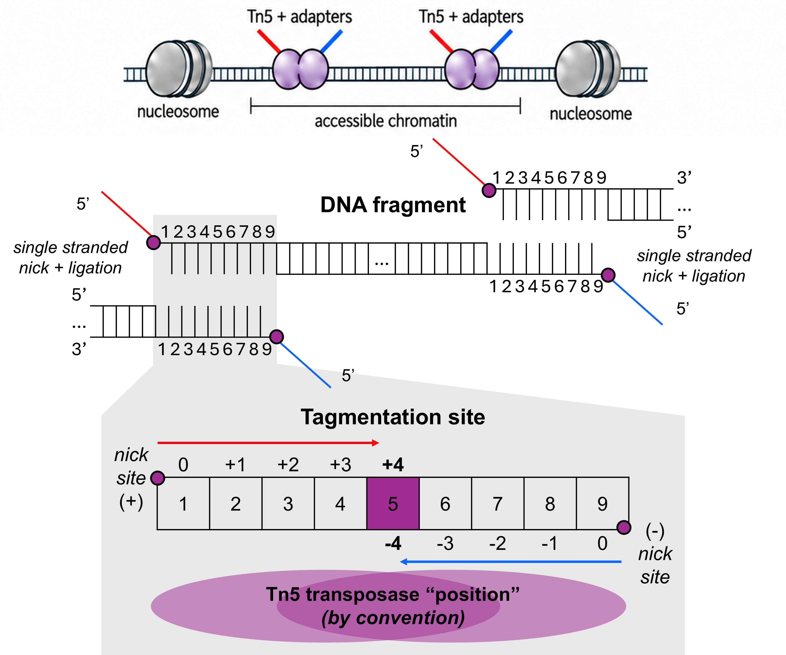
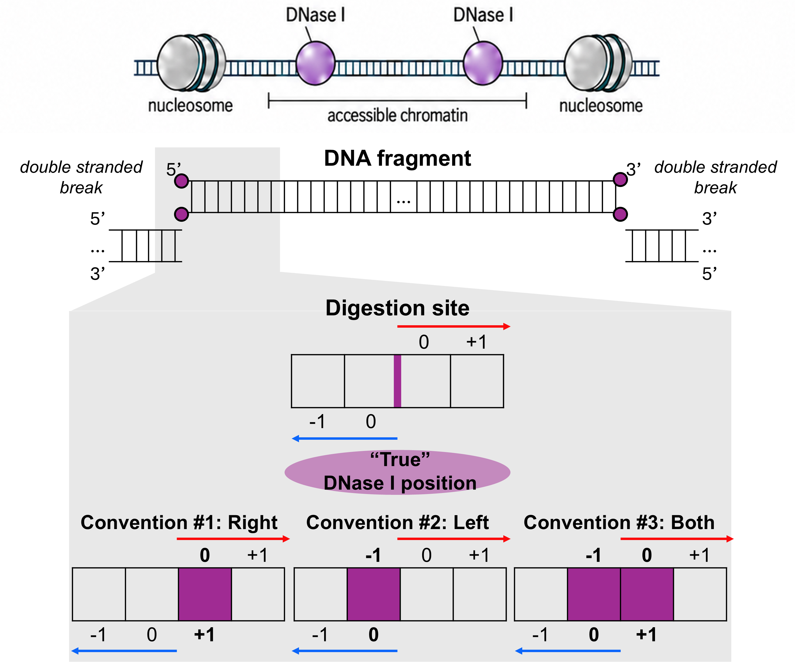
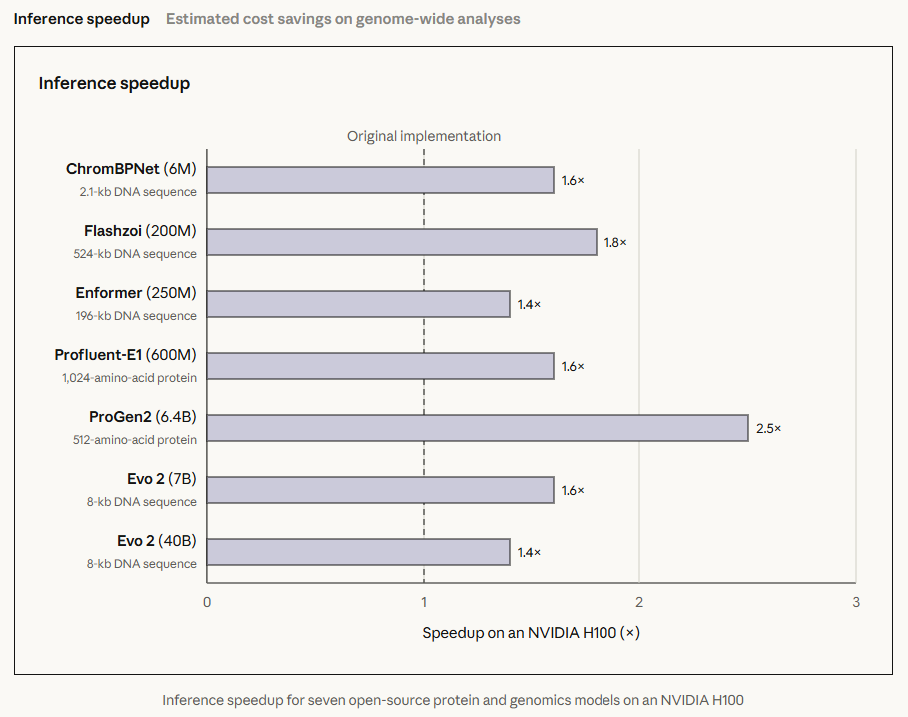


__ChromBPNet__ is a deep learning DNA sequence model that models chromatin accessibility, at base-resolution with DNase I/Tn5 transposase enzyme bias-factorization. Despite wide use of the model, there have been several improvements that we had been considering. Here, we apply those updates and present a [__refactored codebase of ChromBPNet__](https://github.com/kundajelab/chrombpnet-refactor/), that systematically improves the following: (1) support for all 3 major deep learning frameworks, PyTorch, TensorFlow and JAX, on current releases and GPUs; (2) a corrected, selectable cut-site convention for DNase-seq; (3) the optimizations from Anthropic’s Claude Fable/Mythos 5.1 [model release](https://www.anthropic.com/claude-fable-and-mythos-5-1) that apply to ChromBPNet’s pipeline; and (4) additional optimizations in pre- and post-processing—all with confirmed reproducibility to the original model. We share this study to highlight the benefits of early open access code to the community to help build better software and understanding together.


---
## ChromBPNet: A bias factorized, base-resolution deep learning model of chromatin accessibility

ChromBPNet is a deep learning model of __chromatin accessibility__: how accessible a region of chromatin is—chromatin being the native DNA molecule in eukaryotic cells, that is in complex with other nuclear proteins and RNA to be packaged into a dense, compact structure—that in turn, determines how much the DNA is accessible to other cellular processes, including transcription. Experiments measure the level of accessibility of different regions of the genome in different cell types: “DNase-seq” uses the enzyme DNase I to cut exposed DNA; “ATAC-seq” uses the Tn5 transposase enzyme to insert sequencing adapters into accessible DNA. Depending on how accessible the region is, the enzymes DNase I/Tn5 transposase have more/less access to the DNA to perform their activities. By sequencing and mapping the resulting DNA fragments and their suggested enzyme activity sites, chromatin regions that contain many mapped fragments are quantified as highly accessible (as “peaks”) while regions with low fragments are quantified as inaccessible (as “non-peaks”).

However, the enzymes DNase I and Tn5 transposase also have preferences for particular DNA sequences, so the observed signal profiles reflect both genuine chromatin accessibility and assay-specific sequence bias. Separating these components is especially important when interpreting the signal at single-base resolution.

Here, ChromBPNet was developed to learn to predict chromatin accessibility signal from DNA sequence, at base-resolution with the explicit factorization of the enzyme’s sequence bias. ChromBPNet, together with robust model interpretation methods, has previously been shown to predict accessibility in unseen chromosomes, identify the binding preference and binding sites of known, cell type-specific transcription factors (TFs) that influence accessibility, and predict the effects of genomic variation on accessibility (caQTLs) across cell type and population—which we expanded to train 1,512 ChromBPNet models as part of [ENCODE GRAMMAR](https://genomicsxai.github.io/blogs/2026-012/).

However, while highly effective, like any model, ChromBPNet had room for improvements.

## 1. Support all 3 major deep learning libraries, on modern hardware: PyTorch, TensorFlow, JAX

> Note: We are grateful for [Eugenio Mattei](https://github.com/emattei) at the Broad Institute for implementing a JAX version of the original ChromBPNet, that inspired our expansion to other libraries.

__Problem__: Deep learning advances rapidly. While development of the original ChromBPNet began in 2021, and hence developed on the latest deep learning packages and hardware at the time—TensorFlow 2.8 on Python 3.8—the deep learning stack has rapidly accelerated since, making ChromBPNet incompatible with modern versions.

__Solution__: Here, we reimplemented ChromBPNet across all 3 major deep learning libraries: PyTorch 2.14.1 (default), TensorFlow 2.21.0 (with tf-keras 2.21.0, the Keras 2 API), and JAX 0.11.2 (with Keras 3.15.1), all behind one shared, framework-neutral pipeline.

__How to use__: Each engine has its own conda environment, because their frameworks cannot share one. Create the ones you need from the repository root:

| Engine | Create the environment | Then | Python and framework |
|---|---|---|---|
| PyTorch (default) | `conda env create -f envs/chrombpnet-pytorch.yml` | `conda activate chrombpnet-pytorch` | Python 3.12, PyTorch 2.14.1 |
| TensorFlow | `conda env create -f envs/chrombpnet-tensorflow.yml` | `conda activate chrombpnet-tensorflow` | Python 3.12, TensorFlow 2.21.0 (Keras 3.15.1) |
| JAX | `conda env create -f envs/chrombpnet-jax.yml` | `conda activate chrombpnet-jax` | Python 3.12, JAX 0.11.2 (Keras 3.15.1) |

Pick the engine with `--engine` (the checkpoint suffix decides when it is omitted) and the device with `--device cpu`, `cuda` or e.g. `cuda:1`. [`envs/README.md`](https://github.com/kundajelab/chrombpnet-refactor/blob/main/envs/README.md) describes each engine, its GPU libraries, and what differs between them.

## 2. Adaptable cut-site convention for DNase-seq

> Note: We are grateful to our colleagues at [Relation Therapeutics](https://www.relationrx.com/) for identifying this issue to us.

__Problem__: When constructing the experimental “ground truth” signal from the raw sequencing data, we map and count up the exact location that the enzyme was applied on the genome. For ATAC-seq, this is straightforward: Tn5 transposase acts as a homodimer to introduce a “tagmentation”—a single-stranded DNA break, followed by an immediate 5’-to-3’ ligation that attaches adapter sequences to the break (for later sequencing)—at two nearby sites that are 9 bp apart, one on each strand. Hence, to identify the exact position that the Tn5 transposase was applied, by convention, we take the middle of the two cut sites that are 9 bp apart as its position—which conveniently, coincides on top of a base (since the 9 bp gap is odd). When both ends of a region of chromatin is “tagmented”, the region is no longer attached to the original long chromatin and free as a DNA fragment, which can then be sequenced by next generation sequencing (NGS). Hence, to identify the position of the Tn5 transposase from only one DNA fragment, we trace back the other cut site that must have occurred 9 bp away, and identify its middle position, which is equivalent to positions +4 bp or -4 bp (depending on the strand direction) from the 5’ end of the sequenced fragment (only a read’s 5’ end marks a cut; its 3’ end is merely where sequencing stopped. With paired-end data, the 5’ ends of the two mates are the fragment’s two ends, so both cuts are counted). This results in one distinct base pair position per enzyme effect site.

However, for DNase-seq, identifying the exact position of the enzyme activity is trickier: DNase I cleaves at just one site and the “middle” position is not on top of a specific base pair position, but _between_ two base pairs, i.e., on a specific _bond position_. For DNase-seq, DNase I only introduces one cut: a single double-stranded break between two base pairs. Hence, the “position” of the DNase I would ideally also be at the middle of the two base pairs, or on the cleaved bond itself. However, since we in genomics use one-hot-style sequence encoding, we must place the DNase I on some base pair position. By convention, we can either place the DNase I on the right-hand side of the break (which would imply the positions 0 bp or +1 bp from the sequenced 5’ end, depending on the strand), or on the left-hand side of the break (which would imply positions -1 bp or 0 bp from the sequenced 5’ end, depending on the strand), or on both sides of the break (which would imply positions 0 and -1, or 0 and +1, depending on the strand). In the original ChromBPNet, we had selected the right-hand side convention: 0 bp on the positive strand, +1 bp on the negative strand. This ensured that irrespective of which direction of the break was sequenced, we stacked counts on the same base pair position.

However, the issue arises during reverse complement augmentation of the data. In DNA sequence models, we are often (un)fortunate to double our data for free/need to take into account the opposite strand’s sequence, by taking the reverse complement of the original data. ChromBPNet also followed this training protocol: for a random half of the training examples, it takes the reverse complement of the input sequence and reverses the signal profile. However, when taking the reverse complement of the sequence, we cannot simply also take the reverse complement of the signal: the reverse complement not only inverts the sequence, but also inverts the enzyme position convention. For a single symmetric convention, such as ATAC-seq, the inversion is still identical. However, for a non-symmetric convention, such as DNase-seq, the inversion led to two different conventions between the original data and the reverse complement-augmented data: right-hand convention for the original data, and left-hand convention for the reverse complement-augmented data.

This explained several phenomena we had observed. First, during evaluation of ChromBPNet, comparing model performance on ATAC-seq vs. DNase-seq, while the counts head prediction (= predicted total counts inside the 1 kb region) performance was comparable between the two assays (ATAC-seq: ~0.7 vs. DNase-seq: ~0.7; Pearson correlation; higher = better), the profile head prediction (= predicted distribution of the total counts, as a probability distribution; where counts x prediction = predicted signal) performance was significantly worse in DNase-seq (ATAC-seq: ~0.4–0.6 vs. DNase-seq: ~0.65–0.9; Jensen-Shannon distance (JSD); lower = better).

. Right: Profile head performance, evaluated by Jensen-Shannon distance (lower = better). While counts head performance is comparable (left), profile head performance in DNase-seq is consistently worse than in ATAC-seq (right).")

Second, this was also observed in benchmarks against other models: in comparison with AlphaGenome, which improved on ChromBPNet’s 1 bp profile predictions by only 1.6% in ATAC-seq but by 6.4% in DNase-seq (relative improvement in profile JSD).

. Top: Comparison on DNase-seq tracks. Bottom: Comparison on ATAC-seq tracks. Value: Relative % improvement in performance. AlphaGenome saw large improvements (+6.4%) on DNase-seq track prediction over ChromBPNet, but saw only marginal improvements (+1.6%) on ATAC-seq track predictions.")

Third, we could artificially reproduce this performance gap: As the same original ChromBPNet model trained on K562 DNase-seq (using the unintentional convention-inversion during reverse complement-augmentation) as the baseline, we compared the model’s performance against those retrained on 6 different training data sources:

1. __forward-only__: the original ChromBPNet’s right-hand side (0/+1) convention training data, but _without_ the reverse complement-augmented data (i.e., half the training data)
2. __reverse complement-only__: the original ChromBPNet’s “right-hand side (0/+1)” convention training using the reverse complement-augmented data _only_ (i.e., the other half the training data; hence, in reality left-hand side (-1/0) convention)
3. __right-hand__: full right-hand side (0/+1) convention, in both forward and reverse complement-augmented data
4. __left-hand__: full left-hand side (-1/0) convention, in both forward and reverse complement-augmented data
5. __both-side (half)__: both-side (0 and -1/0 and +1) convention, by assigning a half count to both sides
6. __both-side (full)__: both-side (0 and -1/0 and +1) convention, by assigning full count to both sides (i.e., double the total counts).

We observed that using half the data (original, or augmented) improved profile performance (in K562 DNase-seq: original: 0.45 vs. forward-only/reverse complement-only: 0.50), while degrading counts head performance (original: 0.71 vs. forward-only/reverse complement-only: 0.68/0.69), since only half the data was used (the same drop was also observed in ATAC-seq: original 0.70 vs. forward-only/reverse complement-only: 0.68). The counts performance was fully recovered when the correct convention was applied across the full, double-augmented data using either right-hand or left-hand side convention (original: 0.71 vs. right-hand/left-hand: 0.71), while the improved profile head performance was maintained (forward-only/reverse complement-only: 0.50 vs. right-hand/left-hand: 0.50). Both both-side (0 and -1/0 and +1) conventions (half, full) showed recovered counts head performance (original: 0.71 vs. both-full/half: 0.70) and the highest profile head performance (forward-only/reverse complement-only/right-hand/left-hand: 0.50 vs. both-full/half: 0.56), due to smoothed profiles.

, using the original ChromBPNet preprocessing without reverse complement-augmented data. `rc-only`: Reverse complement only (`--data-aug revcomp-only`), using the original ChromBPNet’s reverse complement augmentation data only. `right`: Corrected right-hand side (0/+1) convention. `left`: Corrected left-hand side (-1/0) convention. `both-half`: Both-side (0 and -1/0 and +1) convention, assigning half count to both sides. `both-full`: Both-side (0 and -1/0 and +1) convention, assigning full integer count to both sides. Red: Counts head performance, evaluated by Pearson correlation (higher = better). Blue: Profile head performance, evaluated by 1 - JSD (higher = better). Repeated in ATAC-seq and DNase-seq in the same cell line (K562) and primary cell type (stomach).")

Further, we also investigated the cross-evaluation between the newly trained models and their corresponding test set with the original model and its test set, by evaluating the newly trained models on the original model’s test set and vice versa. We observed that the right-hand side convention model performed the best on the original ChromBPNet model’s test set on both matched counts head prediction (original: 0.71 vs. right-hand: 0.71) and improved profile head prediction (original: 0.44 vs. right-hand: 0.49), followed by forward-only model with similarly improved profile head prediction but degraded counts head prediction (as trained on half the data). Both both-side conventions showed the same performance as the original model (original: 0.44 vs. both-half/full: 0.44), suggesting that the training scheme was effectively equivalent. And left-side convention and reverse complement-only performed the worst, with profile head prediction degrading dramatically as predictions were constantly off by one (due to convention differences), with only half the training data used by the reverse complement-only model. Lastly, evaluating the original ChromBPNet model on the newly processed test sets, the original model performed the best on the both both-side convention test sets, as well as the actual both-side models trained on its own data convention (original: 0.56 vs. both-half/full: 0.56), further confirming that the training schemes were effectively equivalent, and the original model was effectively predicting a both-side convention signal. The original model showed equally degraded profile head performance on right-hand and left-hand side conventions, suggesting a symmetric prediction off by half the counts.

.")

 on each newly trained model’s test set. `original`: The original ChromBPNet model. `original-refactor`: The original ChromBPNet preprocessing, implemented in `chrombpnet-refactor`. `fr-only`: Forward-only (`--data-aug forward-only`), using the original ChromBPNet preprocessing without reverse complement-augmented data. `rc-only`: Reverse complement only (`--data-aug revcomp-only`), using the original ChromBPNet’s reverse complement augmentation data only. `right`: Corrected right-hand side (0/+1) convention. `left`: Corrected left-hand side (-1/0) convention. `both-half`: Both-side (0 and -1/0 and +1) convention, assigning half count to both sides. `both-full`: Both-side (0 and -1/0 and +1) convention, assigning full integer count to both sides. Red: Counts head performance, evaluated by Pearson correlation (higher = better). Blue: Profile head performance, evaluated by 1 - JSD (higher = better). Repeated in ATAC-seq and DNase-seq in the same cell line (K562) and primary cell type (stomach).")

From the investigation, we could conclude what was happening: the model, (unintentionally) trained on half right-hand side convention (from the original data) and half left-hand side convention (from the reverse complement-augmented data), was predicting an expectation between the two data conventions, which happened to coincide with the both-side convention.

__Solution__: Moving forward, we have implemented the following fixes and suggestions:
- DNase-seq cut site convention is now an optional argument (`--dnase-convention`): `right` (for right-hand side), `left` (for left-hand side), `both-half` (for both-side, with half counts each; default), `both-full` (for both-side, with full integer counts each), and `right-deprecated` (the original ChromBPNet’s behaviour, kept only to reproduce earlier runs). `--data-aug` separately chooses which examples are reverse complemented (`augment`, the default; `forward-only`; `revcomp-only`). This allows for all conventions to be possible during training as needed (user should remember which convention was used..!). The default setting is now `both-half` (for reasons explained next).
- Previously trained ChromBPNet models predict a `both-half`-like convention. (And new, refactored default models will be backwards-compatible). We are currently in the process of updating the training, validation, and test set observed signals, as well as the correct convention-based model performance evaluations. We plan to share another update once this is ready.

## 3. Anthropic’s Claude Fable/Mythos 5.1 optimizations: Fused kernels and faster I/O (mostly faster I/O)

An exciting side-project to this refactoring was hearing about Anthropic’s recent [model release of Fable/Mythos 5.1](https://www.anthropic.com/claude-fable-and-mythos-5-1) and their case study of optimizing several DNA sequence models—including ChromBPNet. We always welcome any and all improvements to our models from the community, and thought that this refactoring opportunity would be a great chance to deep dive into Fable/Mythos’ suggestions and incorporate them as needed. Anthropic’s optimizations were [released on Sep 17, 2026](https://github.com/anthropics/uplifting-biomolecular-modeling/).

__Problem__: Anthropic’s optimizations focused on drop-in optimization kits that speed up the inference pipeline of existing DNA sequence models. This includes preprocessing input data, loading model weights, model inference, any post-processing output data, and final write of the output file. For ChromBPNet, this meant optimizing the prediction pipeline `pred_bw`, which predicts over a set of regions and writes the predictions as BigWigs. The optimization kit reported a 1.6x speedup over the original implementation, on an NVIDIA H100.

Below is a summary of changes applied in the [optimization kit](https://github.com/anthropics/uplifting-biomolecular-modeling/tree/main/chrombpnet) from the model release of Fable/Mythos 5.1:

| Kit optimization | What does it do? | Measured effect (vs. original `chrombpnet`): On L40S | On H200 | Applied in `chrombpnet-refactor`? |
|---|---|---|---|---|
| 1. `prefetch` | Reads the genome through a memory map; one-hot encodes with an int8 lookup table | 15x faster (3.6 s → 0.2 s) | 15x (3.6 s → 0.2 s) | ✓ |
| 2. `metrics_stage` | Computes the profile JSD for all regions at once, with the same random stream | 10x faster (9.8 s → 1.0 s) | 10x (9.1 s → 0.9 s) | ✓ |
| 3. `bigwig_writer`, side processes | Writes the bigWig and metrics in a separate process, during the GPU forward | Save write time (23 s → 0.6 s) | 22 s → 0.6 s | ✓ |
| 4. `preimport` | Imports SciPy and Matplotlib on a background thread during the forward | Save 1.3 s in imports | 1.8 s | ✓ |
| 5. `exit_fast` | Exits without interpreter and CUDA teardown once outputs are verified | Save teardown (1.2 s → 0 s) | 1.2 s → 0 s | ✓ |
| 6. `forward_route` (Triton kernels) | Fused, fp32-exact Triton forward | 2.3x faster (34 s → 15 s) | 2.6x (25 s → 9.5 s) | Optional (`--predict-fused-kernel`); slower in `chrombpnet-refactor` [L40S: 76 s → 79 s; H200: 66 s → 73 s] |
| 7. `h5_writer` | Compresses the predictions HDF5's chunks on a thread pool and writes them directly | 17x faster (3.7 s → 0.2 s) | 14x (3.4 s → 0.2 s) | ✓ |
| 8. `malloc_env` | glibc memory-allocator settings: freed memory is kept for reuse instead of returned to the system, and the heap grows 512 MiB at a time | – | – | ✗: faster but holds more memory [L40S: 76 s → 72 s; H200: 66 s → 59 s] |
| 9. `warmup`, `jit_cache`, `native_dilation`, `tail` | One forward per batch shape at load time; a CUDA JIT cache for TensorFlow's PTX; dilated convolutions as native `conv2d`; the last batch padded to full size | – | – | – |
| **All adopted kit changes** | | **2.8x** | **3.7x** | - |

_Original `chrombpnet`: the kit's pinned chrombpnet 1.0.1 and model (GM12878 ATAC-seq, fold 0) running `pred_bw` on 20,000 ENCSR868FGK peaks at batch size 256; medians of 5 rounds. The kit has no per-change switch, so each row compares one stage's time in stock chrombpnet and in the kit's `fast` mode (for stages run alongside the forward pass, the time left waiting); `malloc_env`, which changes no stage, compares whole runs with and without it. Totals: the kit's modes against `--mode off` (85 s on the L40S, 76 s on the H200); `fast` uses the Triton kernels on the H200 but not on the L40S, where `exact` adds them. In brackets, `chrombpnet-refactor`'s default `pred_bw` (each fold's three models on the same peaks; medians of 15 runs, 5 folds × 3 rounds) without → with that change. Every configuration ran in the same job, after an untimed warm-up, in a different order each round._

While the kit's speedup is very useful for users of the original package (1.7x on an L40S, 2.8x with its fused kernels; 3.7x on an H200, where its default mode runs them), interestingly, in our port most of the kit’s gain came not from faster model inference but by running CPU I/O in parallel with GPU inference: writing each model’s BigWig and metrics in a worker process while the next model predicts (~8% of wall clock), and importing the post-processing libraries in the background (~11%). If allowing for flexible file size and constraining only for identical value, the write of the BigWig could be further sped up by 3.1x with 1.5x smaller files using fixed-step bigWigs (implemented in Section 4; not part of Anthropic's optimization kit). Further, the kit's fused kernels did not actually show speed up in our port: `pred_bw` took 79 s with them and 76 s without on an L40S, and 73 s against 66 s (11% longer) on an H200, with only some very minor gains in numerical accuracy, using fp32-exact kernels (vs. eager TF32 convolutions). In the original package they replace TensorFlow 2.8's forward and cut it from 34 s to 15 s on an L40S; in ours they replace PyTorch's, which is already as fast. Given the limited use of the kernels, we kept them as optional (can be used with `--predict-fused-kernel`).

## 4. Additional optimizations in pre- and post-processing

Further, we have implemented several additional optimizations in the pre- and post-processing workflows, including vectorized GC-matched non-peak selection, faster and smaller BigWigs with fixed-step sections, a shared, cleaner command line, and one random seed per command for deterministic reproducibility:

| Change | What does it do? | Measured effect: On L40S | On H200 |
|---|---|---|---|
| 1. Shared inputs across models | Featurizes the regions and reads the observed bigWig once for all models | 2.9x faster (13.0 s → 4.5 s) | 2.9x faster (12.8 s → 4.4 s) |
| 2. Fixed-step bigWigs | The same values, written as fixed-step instead of variable-step sections | 3.1x faster (21.2 s → 6.8 s); files 1.5x smaller (158 → 109 MB) | 3.1x faster (19.6 s → 6.2 s) |
| 3. NumPy bigWig writer arguments | Builds the writer's arguments as arrays | 1.1x faster (21.2 s → 19.7 s) | 1.1x faster (19.6 s → 18.2 s) |
| 4. Batched cast into a preallocated output | Casts and transposes each batch as it is needed | 1.0x faster (15.2 s → 15.1 s); 714 MB less peak memory | 1.1x faster (6.3 s → 5.9 s) |
| 5. Threaded, maximum HDF5 compression | `*_predictions.h5`, `*_scores.h5`, `*_footprints.h5` and TF-MoDISco's results at gzip 9 (was 4) with byte-shuffle; identical values | 7.7x faster to gzip 9 (23.8 s → 3.1 s); Files 1.2x smaller (92 → 76 MB) | 7.5x faster to gzip 9 (21.9 s → 2.9 s); Files 1.2x smaller (92 → 76 MB) |
| 6. GC-matched non-peaks | Candidates as compact arrays, shuffled once per fold, sorted by GC bin and drawn without replacement, with a binary search for the nearest non-empty bin | 54x faster (200 s → 3.7 s); peak memory 1.3 → 0.4 GB | 52x faster (192 s → 3.7 s); peak memory 1.3 → 0.4 GB |
| 7. One random seed per command | Every random draw (negatives, initial weights, jitter, interpretation subsample, DeepLIFT/DeepSHAP references) follows it | Reproducible seed | Reproducible seed |
| 8. Standardized command line interface | One shared, framework-neutral pipeline behind `--engine` and `--device`; options validated before any output directory is created | Standardized CLI | Standardized CLI |
| **All of the above** | Every optimization above and in Section 3, vs. chrombpnet 1.x (TensorFlow 2.8) on its own models, in the same job | **2.6x faster (194 s → 76 s)** | **2.6x faster (168 s → 66 s)** |

_Timed one change at a time on fold 0, each in a fresh process, in a different order each round, medians of 3 rounds (2 for GC matching). HDF5 sizes are for one model's `*_predictions.h5` for 20,000 peaks._

Against the original ChromBPNet (TensorFlow 2.8, as shipped), on the same GPU (an L40S) and folds. cherimoya writes no predicted bigWigs or HDF5 files, so it is compared only on the head-to-head rows (↳), where each chrombpnet package runs its own command with those writers switched off:

| Command (L40S) | Original ChromBPNet (reference) | chrombpnet-refactor (PyTorch) | cherimoya |
|---|---|---|---|
| `pred_bw`: 3 models, 20,000 peaks; predicted bigWigs, predictions HDF5, metrics against the observed bigWig | 194 s | 76 s (2.6x) | _(no equivalent command)_ |
| ↳ Best comparison: one model's predictions over the 20,000 peaks, scored against the observed bigWig; nothing written (cherimoya `evaluate`) | 54 s | 29 s (1.8x) | 15 s (3.6x) |
| `contribs_bw`: DeepLIFT/DeepSHAP on the profile head, 2,000 peaks; scores HDF5 and bigWig | 341 s | 257 s (1.3x) | _(no equivalent command)_ |
| ↳ Best comparison: the attributions alone, 20 shuffled references per sequence; nothing written (cherimoya `attribute`) | 334 s | 252 s (1.3x) | 161 s (2.1x) |

_In parentheses: the speedup over the original ChromBPNet. `pred_bw`: the same runs as in Sections 3 and 4. `contribs_bw` and the head-to-head rows: one job over the same 5 folds, medians of 15 runs (5 folds × 3 rounds) per command, each after an untimed warm-up and in a different order each round. cherimoya 0.3.1 (PyTorch 2.13, in a container on our cluster) ran its own commands on the same inputs with CATv1's ENCSR868FGK models, which use the same folds; medians of 15 runs (5 folds × 3 rounds) after an untimed warm-up, which also compiles its kernels (2-7 minutes the first time on a machine). Its `evaluate` predicts with one model (cherimoya has no bias factorization) and writes only a table of metrics; its `attribute` uses DeepLIFT/DeepSHAP with 20 dinucleotide-shuffled references per sequence, as chrombpnet's DeepLIFT/DeepSHAP does, and writes NumPy arrays. In the head-to-head rows, chrombpnet's `pred_bw` uses the full model only._

## 5. Reproducibility: Confirming parity with the original ChromBPNet

Given all the changes, we confirmed performance parity with the original [ChromBPNet](https://github.com/kundajelab/chrombpnet/) based on reproducibility on: (1) test set chromosome performance, and (2) model interpretation via DeepLIFT/DeepSHAP contribution scores.

Reproducibility of model performance is evidently important. Comparing the performance of the models trained on the refactored codebase (using the default `both-half` convention for DNase-seq), across all 3 deep learning engines (PyTorch, TensorFlow, JAX) against the (pretrained) original ChromBPNet model and an original ChromBPNet model retrained with the original codebase (the run-to-run reference): we observe near-perfect reproducibility across all 3 engines, in ATAC-seq and DNase-seq, in cell lines (K562) and primary cells (stomach), on counts/profile head performance, across all 5 chromosome folds. DNase-seq profile scores rise (K562: 0.33 to 0.48; stomach: 0.23 to 0.35, 1 - JSD) because the refactored models are trained and evaluated on the `both-half` signal: the original model scores as well on that test set (cross-evaluation above), so the gain reflects the evaluation target rather than a better model.

`: A newly trained ChromBPNet model using the original codebase. `pytorch`: A refactored ChromBPNet model using PyTorch. `tensorflow`: A refactored ChromBPNet model using TensorFlow. `jax`: A refactored ChromBPNet model using JAX.")

The robust model interpretation methods have been a key advantage of ChromBPNet, and hence reproducibility of model contribution scores was key. Comparing the DeepLIFT/DeepSHAP contribution scores from each model against the original ChromBPNet’s DeepLIFT/DeepSHAP scores, we observe that contribution scores can be difficult to reproduce perfectly, with only 20 reference sequences (optimized between reproducibility and compute). To quantify the variance in DeepLIFT/DeepSHAP contribution scores, we observed that DeepLIFT/DeepSHAP scores calculated using the same original, pretrained ChromBPNet model, but with simply a different random seed, could achieve a high but not perfect reproducibility (Pearson correlation: 0.86). Further, with a newly trained model, retrained using the same original ChromBPNet codebase, could only reach a reproducibility of 0.72 correlation, setting the expected upper bound for any reproducibility from a model trained on a changed codebase. Our refactored ChromBPNet codebase reaches this contribution score reproducibility: 0.71–0.72 across the 3 deep learning engines (PyTorch 0.711, TensorFlow 0.722, JAX 0.715). This confirmed the reproducibility of the refactored ChromBPNet codebase across test performance and contribution scores.

`: A newly trained ChromBPNet model using the original codebase. `pytorch`: A refactored ChromBPNet model using PyTorch. `tensorflow`: A refactored ChromBPNet model using TensorFlow. `jax`: A refactored ChromBPNet model using JAX.")

## 6. Supplementary: Additional improvements to model structure and usability (that deviate from original ChromBPNet)

Lastly, we’ve added a few non-backward compatible improvements to the model (that will remain optional, given the demand for backward compatibility), but we _highly recommend_ using them moving forward.

### Profile-only bias model

The original ChromBPNet pretrained a small bias model to learn the sequence preference of the assay enzyme (DNase-seq: DNase I, ATAC-seq: Tn5 transposase), predicting the enzyme’s effect on both the total accessibility reads across 1,000 bp window (counts head prediction) and on the distribution of the sequencing reads (profile head prediction). However, the enzyme’s bias is typically not strong enough to affect the general accessibility of a broad, 1,000bp window (e.g., it does not newly open closed chromatin). Its effects are largely local, applying a local preference once it accesses already open chromatin, shifting the signal toward its preferred sequences. Hence, after training many ChromBPNet models for ENCODE GRAMMAR, we observed that the bias model (which is mostly fixed across ENCODE GRAMMAR for each assay type anyway, as enzyme bias is largely constant across cell type environments) was largely contributing nothing towards the counts head predictions, and almost exclusively contributing to the profile head predictions. This is also in alignment with its training: 1) The bias model is pretrained on nonpeaks only, so its trained dynamic range is highly limited. 2) A “good” bias model often showed strong profile head performance, but could show very poor counts head performance, often even with negative correlation (i.e., predicting in the “opposite” direction of a tiny accessibility signal; suggesting noise). Hence, instead of contributing non-predictable counts “noise”, as well as confound gradients during training, in `chrombpnet-refactor`, we now train a bias model that predicts reads distribution _only_ (profile head only), and is connected only to the profile head prediction of the full ChromBPNet model.

 Counts predicted by the three main ENCODE GRAMMAR bias models on held-out chromosomes, against total observed counts: nearly the same in peaks (red) as in non-peaks (blue). (2) Total predicted counts with vs. without the bias model, across 1,502 ENCODE GRAMMAR ChromBPNet models: the bias model adds a median 11.5%.")

With the new profile-only bias model, we repeated the prediction and contribution score reproducibility analysis [above](#5-reproducibility-confirming-parity-with-the-original-chrombpnet), and observed similar reproducibility—confirming that using a  profile-only bias model can reliably reproduce the original ChromBPNet's performances.

 and DeepLIFT/DeepSHAP scores against the original model's (bottom). `original`: the original TensorFlow model; `original (newly trained)`: retrained with the original codebase (white); `original (same model; diff seed)`: the original model rescored with another seed (grey). `chrombpnet-refactor (default)`: backward compatible (`pytorch` above). `chrombpnet-refactor (updated)`: profile-only bias model and Pearson r/JSD checkpoint selection.")

### Student-Teacher distillation

Another learning from ENCODE GRAMMAR (and following from the results shown by related models e.g., AlphaGenome): instead of using all k-fold models (from cross-validation) as an ensemble for downstream tasks (e.g., bias-corrected prediction, contribution scores), we have implemented an option to distill the ensemble of fold models (as a Teacher) into one (Student) model. During distillation, the single Student model trains on the k-fold ensemble’s mean predictions. The benefit of distilling k-fold folds into one model is the ease of use: instead of repeating k x downstream processes, then ensembling to obtain the average, downstream processes can now be performed  on one Student model once—without losing much of the benefits of ensembling.

To preliminarily assess the reproducibility of distillation to match ensembling, we again repeated the prediction and contribution score reproducibility analysis performed [above](#5-reproducibility-confirming-parity-with-the-original-chrombpnet) by comparing the 5-fold ensemble vs. a student model distilled on the 5 folds. We observed that the Student model could closely match the predictions and contribution scores of the 5-fold ensembling. Given that the ensembled models are used for most downstream processes, including more applied tasks such as variant effect prediction and TF motif analysis, we acknowledge that the new distilled models require the same scrutiny, and plan to evaluate its broad, applied performance in subsequent work. For best performance, we still recommend using the ensembled models, and only provide the distillation option as a convenience.

 and DeepLIFT/DeepSHAP scores (bottom) of each model against the 5-fold ensemble mean, on ~10,000 shared peaks per dataset (higher = more reproducible). `fold model`: one fold model, against the 5-fold mean it is part of. `LOFO student`: distilled from the 5 fold models on fold k's training chromosomes. `final student`: distilled on every chromosome.")

## [`chrombpnet-refactor`](https://github.com/kundajelab/chrombpnet-refactor/)

Overall, we share a reproducible, refactored version of [ChromBPNet](https://github.com/kundajelab/chrombpnet-refactor/): supporting all 3 major deep learning engines, a corrected DNase-seq cut site convention, several internal and external optimizations—all with confirmed reproducibility in model performance and contributions.

Moving forward, we recommend using the refactored ChromBPNet codebase for __all future use cases of ChromBPNet__. And we continue to invite any further improvements to the model and codebase!

## References
1. Pampari, A. et al. ChromBPNet: bias factorized, base-resolution deep learning models of chromatin accessibility reveal cis-regulatory sequence syntax, transcription factor footprints and regulatory variants. _bioRxiv_ 2024.12.25.630221 (2024). ([https://doi.org/10.1101/2024.12.25.630221](https://doi.org/10.1101/2024.12.25.630221))
1. Yun, C. M. et al. A unified lexicon of predictive DNA sequence motifs from ENCODE transcription factor binding and chromatin accessibility assays. (2025) doi:10.5281/zenodo.17179111. ([https://doi.org/10.5281/zenodo.17179111](https://doi.org/10.5281/zenodo.17179111))
1. The ENCODE Project Consortium et al. The Encyclopedia of DNA Elements. _bioRxiv_ 2026.07.06.731365 (2026). ([https://doi.org/10.64898/2026.07.06.731365](https://doi.org/10.64898/2026.07.06.731365))
1. Shrikumar, A., Greenside, P. & Kundaje, A. Learning Important Features Through Propagating Activation Differences. _arXiv_ (2019). ([https://doi.org/10.48550/arXiv.1704.02685](https://doi.org/10.48550/arXiv.1704.02685))
1. Lundberg, S. M. & Lee, S.-I. A unified approach to interpreting model predictions. in _Proceedings of the 31st International Conference on Neural Information Processing Systems_ 4768–4777 (Curran Associates Inc., Red Hook, NY, USA, 2017). ([https://dl.acm.org/doi/10.5555/3295222.3295230](https://dl.acm.org/doi/10.5555/3295222.3295230))
