
[Bolero](https://doi.org/10.64898/2026.10.19.760026) predicts cell-state-specific ATAC signal and gene counts from DNA sequence. We benchmarked it in three settings. The main finding is that Bolero's gains come from the ATAC background reference signal, Bolero's most effective design choice, not from its AP-1 score.

1. **Seen cell state, unseen DNA.** Bolero-10M's test regions overlap the pretraining data of its Flashzoi trunk, so its reported held-out scores are optimistic due to data leakage. We retrained Bolero on NeurIPS BMMC with Scooby's split. Run from DNA alone, Bolero matches the published [Scooby](https://doi.org/10.1038/s41592-025-02854-5) on both ATAC and RNA. It clearly wins only when the reference signal is supplied at inference.
2. **Unseen cell state, unseen DNA.** In the preprint's own DNA-only setting on the fear engram dataset, Bolero does not beat copying the control profile. With the reference signal, it ties or slightly beats copying.
3. **Unseen cell state, seen DNA.** On the KA, Fear and MS datasets, AP-1 adds almost nothing. Measured, shuffled and random AP-1 scores give the same accuracy, and so does Bolero-10M, which has no AP-1 input. For ATAC, Bolero beats the copy-control baseline only when it receives the stimulated cells' own embedding plus the reference signal, so the answer is already in the input. For RNA, it does not beat copy-control.
4. **Cell-state representation.** In both the MultiVI embedding and the condition vector *e*, stimulation moves a cell type only about half as far as its average distance to other cell types. Changing AP-1 shifts every metacell by exactly the same vector regardless of cell type.


---

## Overview of Bolero

- About 75 similar cells inside each cell type × experimental condition are merged into one metacell. Metacells can share cells.
- Neighbouring metacells are pooled into a pseudobulk of ~5 M ATAC fragments.
- From 524 kb of DNA, the model predicts each pseudobulk's ATAC signal (cut sites per 32 bp) and gene counts.
- The gene head sits after the final conv, next to the ATAC head, and outputs a single count for that gene. A gene-body mask is a 0/1 track fed in alongside the DNA, which marks 1 from that gene's transcription start to its end and 0 everywhere else. It is added to the output of the DNA conv stem.
- Three encoders are concatenated into the condition vector *e*, the input of a hypernetwork that generates LoRA weights for every layer of the frozen Flashzoi backbone:
  - Cell encoder: the pseudobulk's mean PMultiVI metacell embedding, plus the mean embedding of ~1,000 background metacells of the dataset.
  - Condition encoder: the released model uses only Tissue. The five datasets below have no condition encoder.
  - Shared encoder: species, and the pseudobulk's AP-1 motif chromVAR score.
- Reference signal is the dataset's own bulk ATAC (the sum of 1,000 sampled metacells, scaled to 5 M fragments). It enters the model after the conv tower, before the U-Net/transformer.
  - Training: the reference signal is given, but dropped on a random 20% of batches.
  - Prediction: the reference signal is optional. With it, Bolero runs in signal-aware mode; without it, it is in DNA-only mode.

Bolero proposes using the AP-1 score to set the trans environment.

- AP-1 is a TF family. Each AP-1 factor is a dimer, a JUN-family protein paired with a FOS-, JUN- or ATF-family protein. It binds the TGA(C/G)TCA motif.
- Both FOS and JUN are immediate-early genes. When a neuron fires, *Fos* is transcribed within minutes. AP-1 then binds enhancers and recruits chromatin remodellers, turning on a larger set of late-response genes.
- The AP-1 score in Bolero is computed from ATAC, as the AP-1 chromVAR score:
  - For each cell, chromVAR takes all peaks that contain the AP-1 motif and measures how much more accessible they are than expected from overall accessibility, resulting in a z-scored deviation.
  - The cells' scores are aggregated and z-scaled on one common scale across all datasets, giving one number per pseudobulk.
  - A high score means the AP-1-bound sites in those cells are more open overall. The score is a second conditioning input, next to the cell-state embedding.
- To predict the stimulated state: keep the control embedding and turn the AP-1 score up or down (for example, for the fear engram dataset the preprint dials the AP-1 score from −1.5 to +8, but the measured difference is only about +1).

## Seen cell state, unseen DNA

Below is adapted from Bolero's Figure 1c, d. Bolero did not compare with Scooby on RNA.

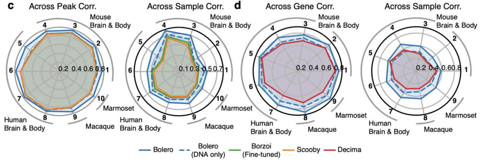

Bolero's Scooby baseline is not the published Scooby. The Methods say only that "a hypernetwork head reproduces the published Scooby model". In Bolero's code, the "scooby" preset puts a Scooby-style head on Bolero's framework, with plain rank-8 LoRA instead of Bolero's cell-state-conditional LoRA.

We therefore ran an additional comparison using the original Scooby and Bolero models. Both Scooby and Bolero were trained on the NeurIPS BMMC dataset, but they used different DNA folds. Thus, we retrained Bolero on the NeurIPS BMMC dataset.

The released Bolero-10M configuration validates on fold 0 and tests on fold 1, although the preprint says it uses Borzoi's split. Its frozen trunk is Flashzoi replicate 0, which was trained on every fold except fold 3 (test) and fold 4 (validation). Bolero's test and validation regions were therefore in the trunk's training data, so there is data leakage and its reported held-out scores are optimistic (see table below).

To avoid this, we retrained Bolero on the same split as Scooby and its trunk: test fold 3, validation fold 4. Neither the trunks nor any retrained model saw the test regions.

| Fold | Scooby LoRA | Bolero-10M LoRA | Scooby trunk: Borzoi | Bolero trunk: Flashzoi | Bolero retrained |
|---|---|---|---|---|---|
| 3 | Unseen | Trained | Unseen | Unseen | Unseen |
| 4 | Validation | Trained | Validation | Validation | Validation |
| 1 | Trained | Unseen | Trained | Trained | Trained |
| 0 | Trained | Validation | Trained | Trained | Trained |
| 2, 5, 6, 7 | Trained | Trained | Trained | Trained | Trained |

Neither Scooby nor Bolero reports a hyperparameter search. Scooby states that "due to computational constraints, extensive hyperparameter optimization was not performed", and the Bolero preprint does not mention hyperparameter tuning.

Bolero has a published single-dataset training configuration (tutorial 06). We used that configuration to retrain Bolero on NeurIPS BMMC with fold 3 as the test fold. We directly used Scooby's published model weights trained on this dataset. No hyperparameter sweep was done. We rebuilt the pseudobulks so that each contains one subclass only and no metacell is shared between pseudobulks (~5 M fragments each), matched to Scooby's 21 cell types. Across-feature *r* is the mean of the 21 per-cell-type Pearson *r*. We then evaluated on fold 3.

Panel order in the figures below:

1. Scooby (published).
2. Bolero without reference signal: an ablation that never sees the reference, in training or at inference, so its input matches Scooby's exactly.
3. Bolero in its DNA-only mode: trained with the reference signal, run without it.
4. Bolero in its signal-aware mode: the same model, run with the reference signal.
5. Bolero-10M, shown for reference only, since it saw fold 3 during training.
6. Dataset-average baseline. As every cell type gets the same value, it carries no cell-type-specific information.

### ATAC

Cross-peak comparison:

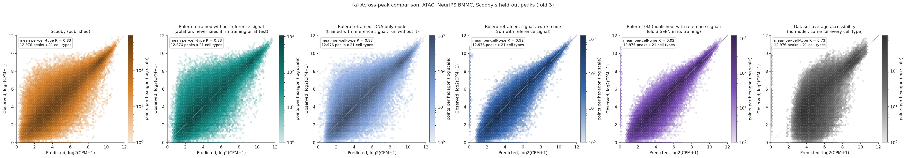

Note that the published Bolero-10M model, which saw fold 3 of this dataset during training, has nearly the same performance as the retrained Bolero model, which did not see fold 3. Thus, the retrained Bolero model's performance is not underestimated here.

Deviation *r* (subtract peak mean and cell type mean):

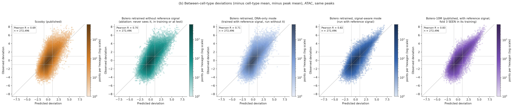

Bolero clearly outperforms Scooby only when the reference signal is added at inference. With or without the reference signal during training, Bolero has roughly the same performance as Scooby.

### RNA

Because Bolero predicts gene counts rather than the RNA coverage that Scooby predicts, here we set the ground truth to be whole-gene 10x counts, matching Bolero's training target.

To match Bolero's whole-gene count, we also converted Scooby's output to a whole-gene readout. For each gene, we sum Scooby's predicted coverage on the gene's strand across the entire gene body, exons and introns, using the same gene span as Bolero. Genes longer than Scooby's 196 kb output window are covered with adjacent windows, and the results are summed.

Cross-gene *r*:

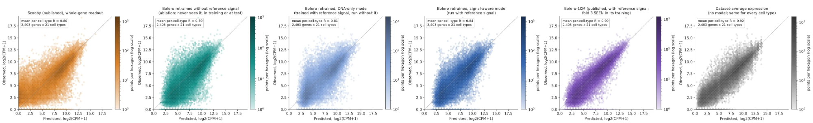

The dataset-average baseline scores highest here because across-gene *r* mostly reflects which genes are highly expressed overall, not cell-type differences.

Deviation *r* (subtract gene mean and cell type mean):

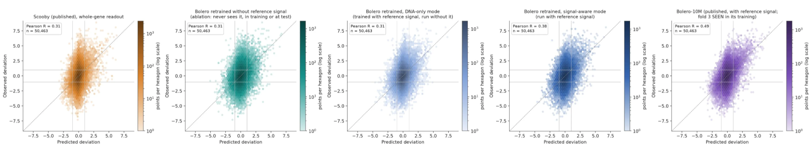

A similar conclusion is observed: without the reference signal at inference, the retrained Bolero's DNA-only performance is approximately the same as Scooby's. When the reference signal is added, Bolero outperforms Scooby.

Bolero-10M scores clearly higher than the retrained model. We cannot tell whether this reflects its leakage exposure to fold 3 or a weaker retrained gene model, so the retrained RNA results may be conservative.

Note that Bolero's gene-count head rarely predicts values near zero, so unexpressed genes are systematically over-predicted.

## Unseen cell state, unseen DNA

Figure 2g–j of Bolero examines the unseen cell types of unseen cell states. Bolero set up a baseline that reads out from the embedding of the nearest states, but did not set up a baseline that copies the observation of the nearest states.

The weights of the 18 individually trained models in Figure 2g–j have not been published, and the test split arrangement is not described either. Thus, we cannot conduct additional benchmarking experiments in the same setting.

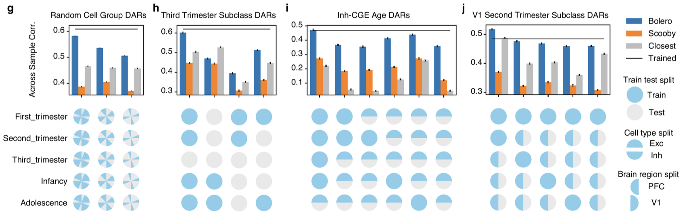

In Figure 4, Bolero is evaluated on five datasets: fear engram (Fig. 4b), novel environment, stress, mouse visual experience and human visual experience.

| Paradigm | Cell type | Prediction input pseudobulk | Group 1 | Group 2 | Bolero's AP-1 dial |
|---|---|---|---|---|---|
| Fear engram (Fig. 4b) | Mouse hippocampus DG | 24 h Trap− DG | Fos-Trap+ DG cells, 24 h group | 24 h Trap− DG (same group) | +8 vs −1.5 |
| Novel environment | Mouse hippocampus CA1 | Control CA1 | Highest-AP-1-score CA1 cells, 1 h exposure sample | Lowest-AP-1-score CA1 cells, same sample | +5 vs −1.5 |
| Stress | Mouse hippocampus CA1 | 45 min handling CA1 | Highest-AP-1-score CA1 cells, 15 min restraint sample | Lowest-AP-1-score CA1 cells, same sample | +1 vs −3 |
| Mouse visual experience | Mouse VIS L2/3 IT | Earlier age group | Age group (33.5, 35.5] | Age group (25.5, 31.5] | +5 vs −1.5 |
| Human visual experience | Human V1 L2/3 IT | Prenatal | Postnatal | Prenatal | +5 vs −1.5 |

For the novel environment and stress datasets, the evaluation is not independent of the model input, because cells are selected by AP-1 score and then predicted with that score.

The last two datasets (mouse VIS and human V1) have all their pseudobulks seen during training. For the other three, the published cell metadata (sample, experimental group, subclass) defines the input and comparison groups exactly for the fear engram (24 h Trap− vs Trap+ DG). For novel environment and stress, the input pseudobulk is defined, but the cells in the highest- and lowest-AP-1 groups are not published, and the preprint does not specify how they were split. Thus, we conducted the benchmark on the fear engram dataset.

We replicated Figure 4b from Bolero on the fear engram dataset.

Bolero Fig. 4a, b:

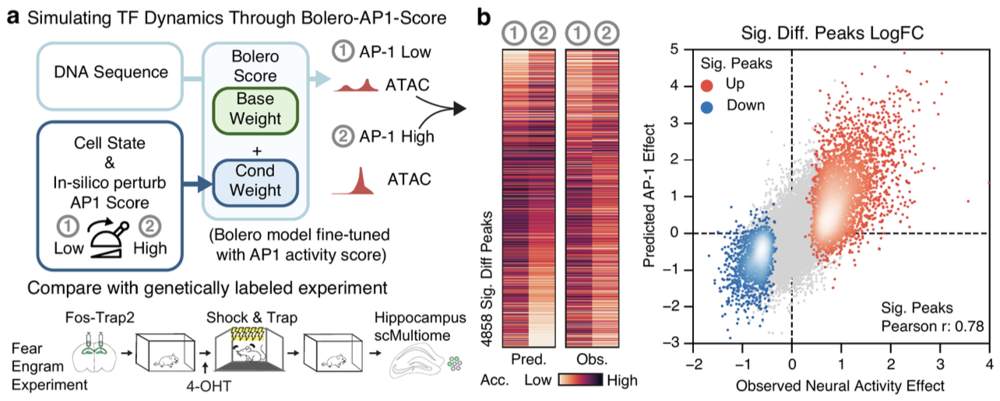

Our replication:

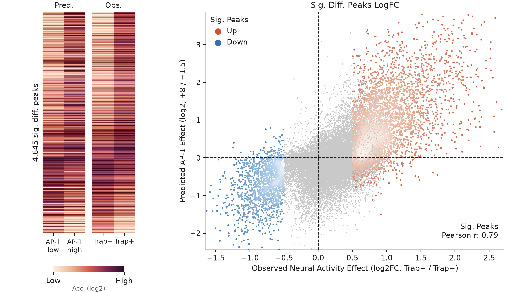

### On AP-1

The authors publish a per-cell chromVAR score for each JASPAR motif, and we took the AP-1 motif (MA0478.2, the same motif the model uses). We averaged this score over all cells in a group and converted it to a z-score, as Bolero was trained on AP-1 values that are z-scores across pseudobulks. The authors' own input file is not public, so this is what we measured: Fos-Trap+ = +0.70, Trap− = −0.31, which is much smaller than the preprint's AP-1 score of +8 vs −1.5.

We used the input (24 h Trap− DG) to predict the perturbed group (24 h Fos-Trap+ DG) from the input's embedding, dialed with the preprint's AP-1 score and with our measured AP-1 score. We also directly predicted the perturbed group from its own cell embedding. All are compared against the baseline of copying the input pseudobulk.

No reference signal. This is the preprint's own setting, as all Fig. 4 predictions were made in DNA-only mode. Here Bolero does not beat copying the control.

, compared with copying the control pseudobulk.")

With the reference signal, Bolero ties or slightly beats copying.

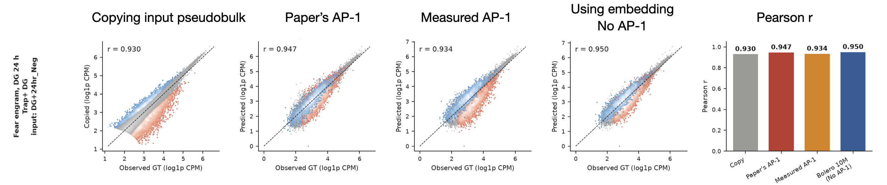

### On cell representation and the encoder

We then explored the cell representation and the encoder output *e* of all cell types between the fear engram groups.

Each dot is a metacell, and each panel highlights one cell type, with blue for its 24 h Trap− metacells and red for the "after" version over a grey background of all cell types. In the first two figures, red is that cell type's Fos-Trap+ metacells, and in the third it is the same Trap− metacells with AP-1 raised to +8.

Cell embedding:

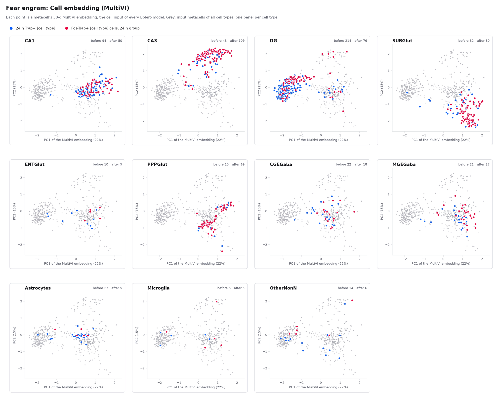

*e* of the embedding:

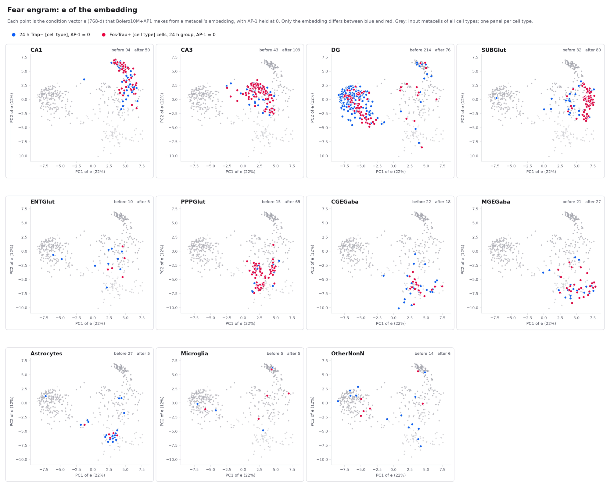

*e* with the AP-1 dial:

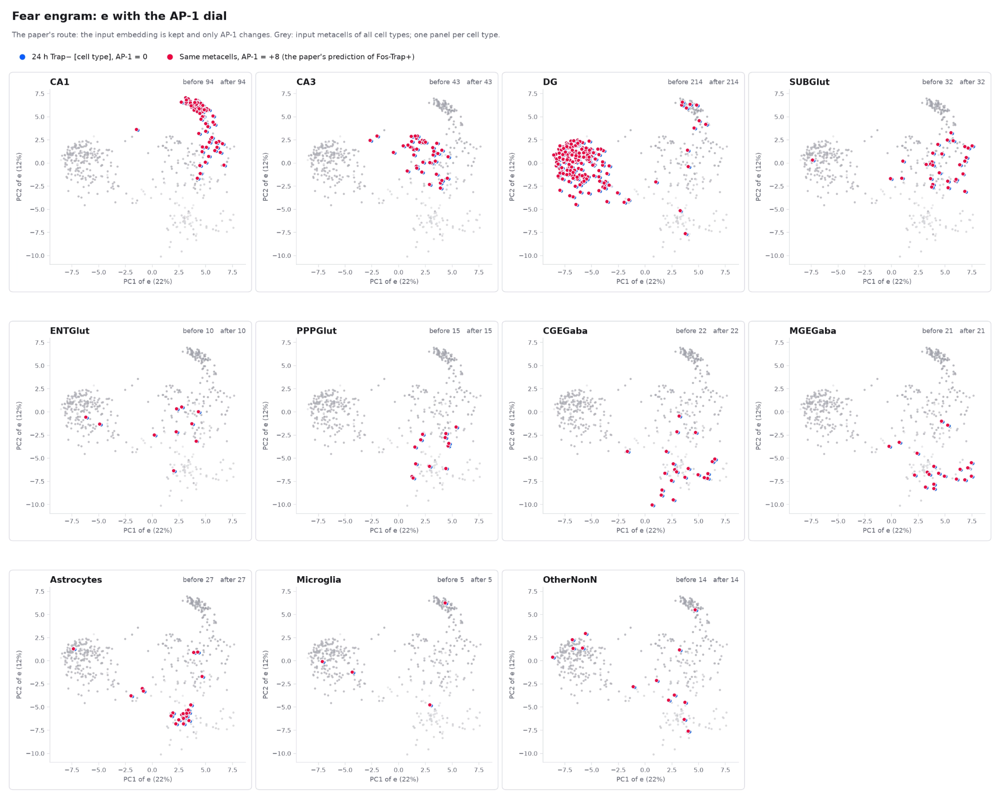

AP-1 only changes *e*. It moves every metacell by exactly the same vector. The moving direction is almost orthogonal to PC1 and PC2.

Below is the distance matrix between cell-type centroids. Rows of panels: MultiVI embedding, *e*, and *e* with the AP-1 dial. First column: distances between cell types within 24 h Trap−. Second column: Fos-Trap+ (rows) vs 24 h Trap− (columns); the boxed diagonal is how far each cell type moved. Third column: distances between cell types within Fos-Trap+.

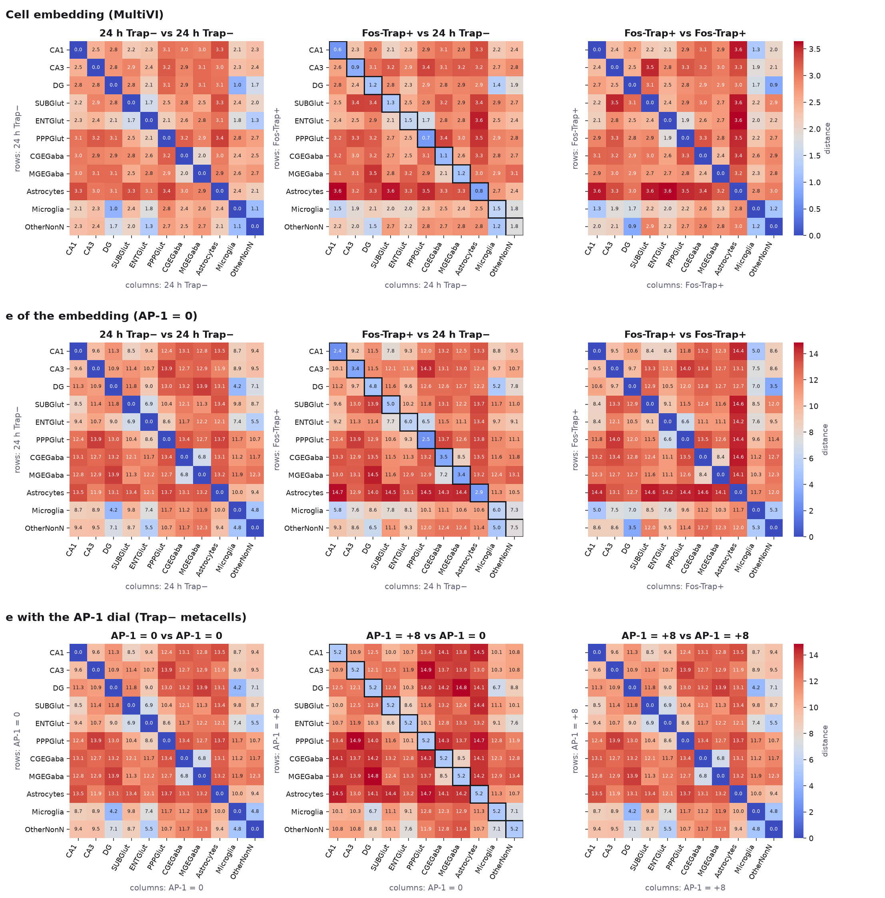

The bar graph of normalized distances sums this up. Stimulation moves a cell type about half as far as its average distance to other cell types.

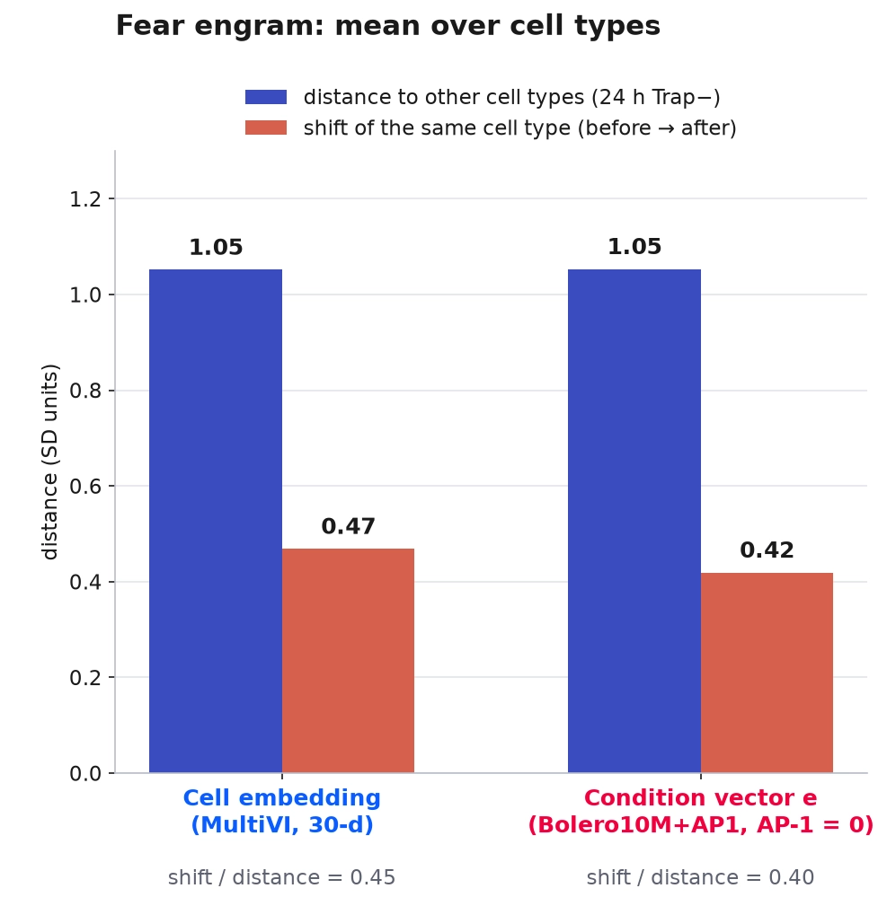

## Unseen cell state, seen DNA

Bolero's Hugging Face repository has five activity datasets. Their control groups were used in training, and their stimulated groups were held out.

| Dataset | Region | Experiment | Control group | Stimulated groups |
|---|---|---|---|---|
| KA | HPF | Inject kainic acid to induce epileptic-like intense neural activity | PBS (inject physiological buffer) | KA2h (2 h after injection) |
| Fear | HPF | Fear conditioning | \*\_Neg (unmarked cells) | \*\_Trap (engram) |
| MultipleSclerosis | Spinal cord | MS mouse model | Ctrl | Early / Late / Peak of MS |
| EE | HPF | Enriched environment stimulation | Ctrl | EE1h / EE6h |
| Stress | HIP | Restraint stress | Handling, 0 / 15 / 45 / 180 min | Restraint, 0 / 15 / 45 / 180 min |

Only Fear (Fig. 4b) and Stress (Fig. 4c) appear in the preprint. KA, MS and EE are not reported.

In the authors' public records, pseudobulks are not independent. Neighbouring pseudobulks of the same cell type share metacells, and some mix metacells from control and stimulated samples. From here on, we drop the mixed pseudobulks and keep only pseudobulks that share no metacell with any other.

We left out EE and Stress. After this filtering, their stimulation effect does not replicate between two independent halves of the data.

The same pattern from before is also here: stimulation moves a cell type about half as far as its average distance to other cell types.

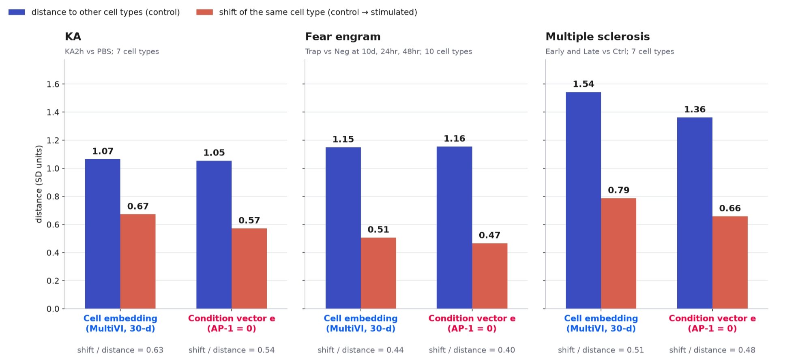

We ran ablations on them. Unlike Fig. 4, these use training-fold peaks, so the DNA was seen in training; only the cell state is new.

The preprint only gives AP-1 settings for specific groups, not for each cell type (see the table in the previous section), so we drew one random AP-1 value per pseudobulk from the preprint's range [−3, 8].

We reconstructed the measured AP-1 score per pseudobulk with the same method mentioned above. In the "measured" settings, the model gets the stimulated pseudobulk's own score. In the "shuffled" settings, the same scores are permuted among pseudobulks within each dataset.

We score only high-coverage peaks (genes), those with ≥ 10 reads (UMIs) on average. Below this, counting noise can dominate the profile.

The ceiling here is *r* between two random halves of each pseudobulk's metacells, corrected to full depth (Spearman–Brown, square root; mean of 100 splits).

Light bars are without the reference signal and dark bars are with it.

The grey bar copies the matched control profile without any model, so it is the baseline to beat (dotted line). The red dashed line is the ceiling, i.e. how well the data agree with themselves. Moving left to right, the model gets more information about the stimulated state: first the control embedding, then the stimulated embedding. Each is run with Bolero-10M (no AP-1 input) and with the AP-1 model (Bolero-AP1-Score in the preprint) given measured, shuffled or random AP-1 in the preprint's range. Coloured dots are the dataset means.

For ATAC:

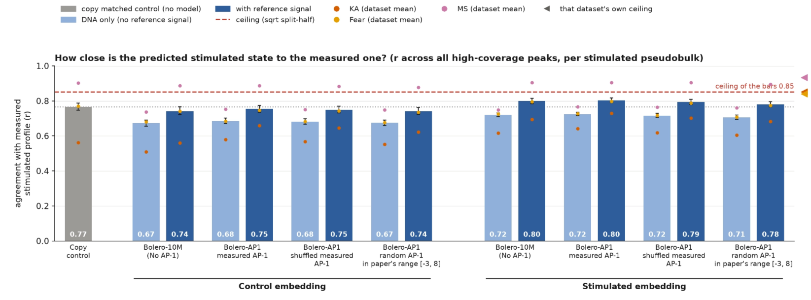

AP-1 adds approximately nothing. Measured, shuffled and random AP-1 give the same *r* (0.80, 0.79, 0.78). Bolero-10M, which has no AP-1 input, also gives 0.80.

The reference signal helps in every setting. Only the stimulated embedding plus the reference signal beats copying the control (0.80 vs 0.77; ceiling 0.85). But the stimulated embedding comes from the measured stimulated cells, so the answer is already in the input.

For RNA, Bolero does not beat the copy-control baseline.

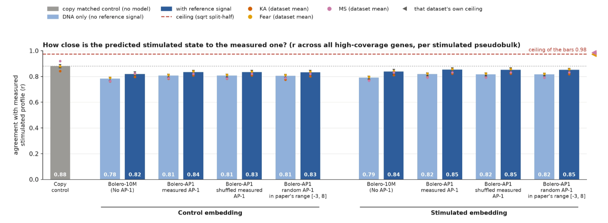

Gene expression changes little after stimulation, so the control profile is already very close. The reference signal helps. The stimulated embedding helps a little (+0.01 without the reference signal, +0.02 with it). Again AP-1 adds approximately nothing, as measured, shuffled and random AP-1 all give 0.85.

## Acknowledgements

This benchmark was possible only because the authors released their code, model weights, data and tutorials, including unpublished datasets.

## References

**Models and code**

1. Liu, H., Mao, S. et al. Predicting cell-state-specific gene regulation from DNA across species. *bioRxiv* (2026). https://doi.org/10.64898/2026.10.19.760026 (Bolero)
2. Bolero code: https://github.com/liuhlab/bolero. Model weights: https://huggingface.co/arcinstitute/bolero-models. Data: https://huggingface.co/datasets/arcinstitute/bolero-data.
3. Hingerl, J. C. et al. scooby: modeling multimodal genomic profiles from DNA sequence at single-cell resolution. *Nature Methods* (2025). https://doi.org/10.1038/s41592-025-02854-5 (Scooby)
4. Linder, J., Srivastava, D., Yuan, H., Agarwal, V. & Kelley, D. R. Predicting RNA-seq coverage from DNA sequence as a unifying model of gene regulation. *Nature Genetics*, 57, 949–961 (2025). https://doi.org/10.1038/s41588-024-02053-6 (Borzoi)
5. Hingerl, J. C., Karollus, A. & Gagneur, J. Flashzoi: an enhanced Borzoi for accelerated genomic analysis. *Bioinformatics*, 41, btaf467 (2025). https://doi.org/10.1093/bioinformatics/btaf467 (Flashzoi)
6. Hu, E. J. et al. LoRA: Low-Rank Adaptation of large language models. *ICLR* (2022). https://arxiv.org/abs/2106.09685 (LoRA)

**Methods**

7. Schep, A. N., Wu, B., Buenrostro, J. D. & Greenleaf, W. J. chromVAR: inferring transcription-factor-associated accessibility from single-cell epigenomic data. *Nature Methods*, 14, 975–978 (2017). https://doi.org/10.1038/nmeth.4401
8. Rauluseviciute, I. et al. JASPAR 2024: 20th anniversary of the open-access database of transcription factor binding profiles. *Nucleic Acids Research*, 52, D174–D182 (2024). https://doi.org/10.1093/nar/gkad1059
9. Ashuach, T. et al. MultiVI: deep generative model for the integration of multimodal data. *Nature Methods*, 20, 1222–1231 (2023). https://doi.org/10.1038/s41592-023-01909-9
10. Persad, S. et al. SEACells infers transcriptional and epigenomic cellular states from single-cell genomics data. *Nature Biotechnology*, 41, 1746–1757 (2023). https://doi.org/10.1038/s41587-023-01716-9

**Datasets**

11. Luecken, M. D. et al. A sandbox for prediction and integration of DNA, RNA, and proteins in single cells. *NeurIPS Datasets and Benchmarks* (2021). (NeurIPS BMMC)
12. Traunmüller, L. et al. Novel environment exposure drives temporally defined and region-specific chromatin accessibility and gene expression changes in the hippocampus. *Nature Communications*, 16, 7787 (2025). (Novel environment)
13. Waag, R. et al. Distinct mechanisms of transcriptomic habituation to repeated stress in the mouse hippocampus. *Nature Communications*, 16, 11569 (2025). (Stress; GEO GSE292240)
14. Multiple sclerosis mouse model: GEO GSE250589.
15. Fear engram, KA and EE: unpublished data from the Bolero authors, released in the Bolero data repository (ref. 2).
